# Module 5: STP Concepts 

# 5.1 Purpose of STP

## 5.1.1 Redundancy in Layer 2 Switched Networks

This topic covers the causes of loops in a Layer 2 network and briefly explains how spanning tree protocol works. Redundancy is an important part of the hierarchical design for eliminating single points of failure and preventing disruption of network services to users. Redundant networks require the addition of physical paths, but logical redundancy must also be part of the design. Having alternate physical paths for data to traverse the network makes it possible for users to access network resources, despite path disruption. However, redundant paths in a switched Ethernet network may cause both physical and logical Layer 2 loops.

Ethernet LANs require a loop-free topology with a single path between any two devices. A loop in an Ethernet LAN can cause continued propagation of Ethernet frames until a link is disrupted and breaks the loop.

## 5.1.2 Spanning Tree Protocol

Spanning Tree Protocol (STP) is a loop-prevention network protocol that allows for redundancy while creating a loop-free Layer 2 topology. IEEE 802.1D is the original IEEE MAC Bridging standard for STP.

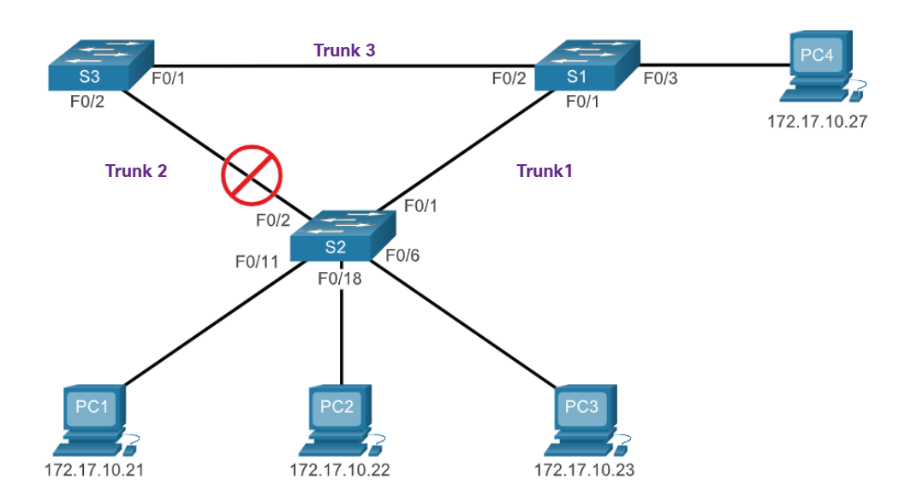

## 5.1.3 STP Recalculation

## 5.1.4 Issues with Redundant Switch Links

Path redundancy provides multiple network services by eliminating the possibility of a single point of failure. When multiple paths exist between two devices on an Ethernet network, and there is no spanning tree implementation on the switches, a Layer 2 loop occurs. A Layer 2 loop can result in MAC address table instability, link saturation, and high CPU utilization on switches and end-devices, resulting in the network becoming unusable.

Unlike the Layer 3 protocols, IPv4 and IPv6, Layer 2 Ethernet does not include a mechanism to recognize and eliminate endlessly looping frames. Both IPv4 and IPv6 include a mechanism that limits the number of times a Layer 3 networking device can retransmit a packet. A router will decrement the TTL (Time to Live) in every IPv4 packet, and the Hop Limit field in every IPv6 packet. When these fields are decremented to 0, a router will drop the packet. Ethernet and Ethernet switches have no comparable mechanism for limiting the number of times a switch retransmits a Layer 2 frame. STP was developed specifically as a loop prevention mechanism for Layer 2 Ethernet.

## 5.1.5 Layer 2 Loops

Without STP enabled, Layer 2 loops can form, causing broadcast, multicast and unknown unicast frames to loop endlessly. This can bring down a network within a very short amount of time, sometimes in just a few seconds. For example, broadcast frames, such as an ARP Request are forwarded out all of the switch ports, except the original ingress port. This ensures that all devices in a broadcast domain are able to receive the frame. If there is more than one path for the frame to be forwarded out of, an endless loop can result. When a loop occurs, the MAC address table on a switch will constantly change with the updates from the broadcast frames, which results in MAC database instability. This can cause high CPU utilization, which makes the switch unable to forward frames.

Broadcast frames are not the only type of frames that are affected by loops. Unknown unicast frames sent onto a looped network can result in duplicate frames arriving at the destination device. An unknown unicast frame is when the switch does not have the destination MAC address in its MAC address table and must forward the frame out all ports, except the ingress port.

## 5.1.6 Broadcast Storm

A broadcast storm is an abnormally high number of broadcasts overwhelming the network during a specific amount of time. Broadcast storms can disable a network within seconds by overwhelming switches and end devices. Broadcast storms can be caused by a hardware problem such as a faulty NIC or from a Layer 2 loop in the network.

Layer 2 broadcasts in a network, such as ARP Requests are very common. A Layer 2 loop is likely to have immediate and disabling consequences on the network. Layer 2 multicasts are typically forwarded the same way as a broadcast by the switch. So, although IPv6 packets are never forwarded as a Layer 2 broadcast, ICMPv6 Neighbor Discovery uses Layer 2 multicasts.

A host caught in a Layer 2 loop is not accessible to other hosts on the network. Additionally, due to the constant changes in its MAC
address table, the switch does not know out of which port to forward unicast frames. In the previous animation, the switches will have the
incorrect ports listed for PC1. Any unknown unicast frame destined for PC1 loops around the network, just as the broadcast frames do.
More and more frames looping around the network eventually creates a broadcast storm.

To prevent these issues from occurring in a redundant network, some type of spanning tree must

## 5.1.7 The Spanning Tree Algorithm

STP is based on an algorithm invented by Radia Perlman while working for Digital Equipment Corporation, and published in the 1985 paper "An Algorithm for Distributed Computation of a Spanning Tree in an Extended LAN." Her spanning tree algorithm (STA) creates a loop-free topology by selecting a single root bridge where all other switches determine a single least-cost path.

Without the loop prevention protocol, loops would occur rendering a redundant switch network inoperable.

### STA Scenario Topology

This STA scenario uses an Ethernet LAN with redundant connections between multiple switches.

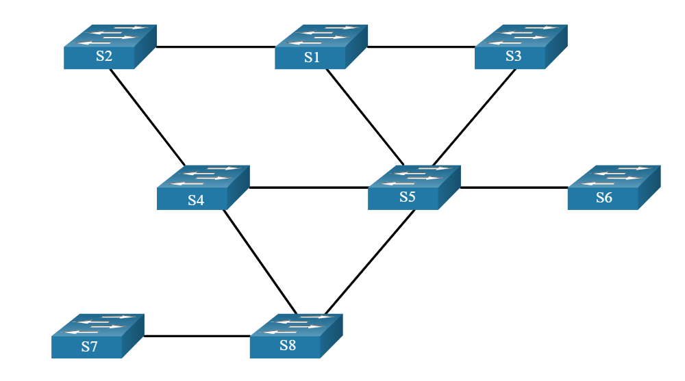

### Select the Root Bridge

The spanning tree algorithm begins by selecting a single root bridge. The figure shows that switch S1 has been selected as the root bridge. In this topology, all links are equal cost (same bandwidth). Each switch will determine a single, least cost path from itself to the root bridge. 

Note: The STA and STP refers to switches and bridges. This is because in the early days of Ethernet, switches were referred to as bridges. 

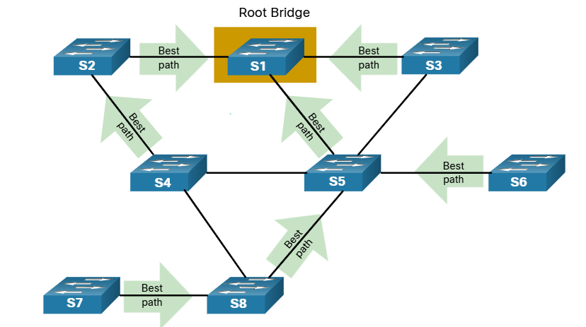

### Block Redundant Paths

STP ensures that there is only one logical path between all destinations on the network by intentionally blocking redundant paths that could cause a loop, as shown in the figure. When a port is blocked, user data is prevented from entering or leaving that port. Blocking the redundant paths is critical to preventing loops on the network.

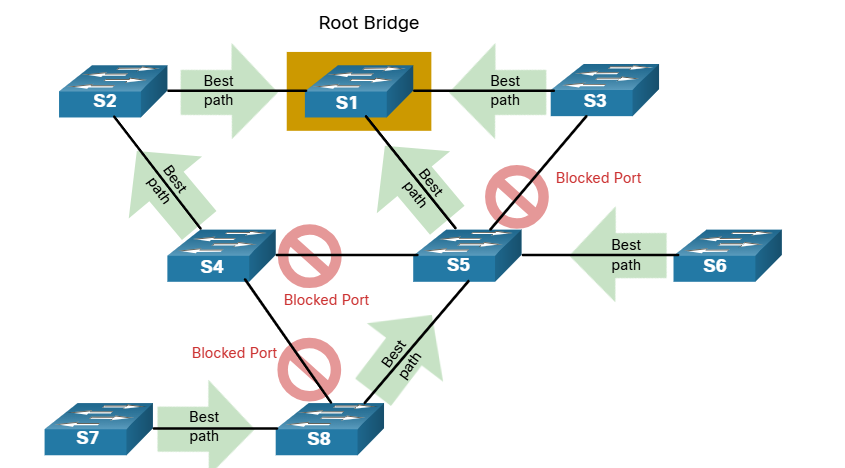

Switches S4, S5, and S8 have blocked redundant paths to the root bridge.

STP prevents loops from occurring by configuring a loop-free path through the network using strategically placed "blocking-state" ports. The switches running STP are able to compensate for failures by dynamically unblocking the previously blocked ports and permitting traffic to traverse the alternate paths.

### Loop-Free Topology

A blocked port has the effect of making that link a non-forwarding link between the two switches, as shown in the figure. Notice that this creates a topology where each switch has only a single path to the root bridge, similar to branches on a tree that connect to the root of the tree.

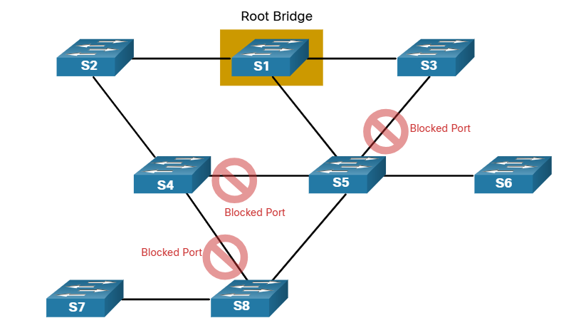

Each switch now has just one forwarding path to the root bridge.

STP prevents loops from occurring by configuring a loop-free path through the network using strategically placed "blocking-state" ports. The switches running STP are able to compensate for failures by dynamically unblocking the previously blocked ports and permitting traffic to traverse the alternate paths.

### Link Failure Causes Recalculation

The physical paths still exist to provide redundancy, but these paths are disabled to prevent the loops from occurring. If the path is ever needed to compensate for a network cable or switch failure, STP recalculates the paths and unblocks the necessary ports to allow the redundant path to become active. STP recalculations can also occur any time a new switch or new inter-switch link is added to the network.

The figure shows a link failure between switches S2 and S4 causing STP to recalculate. Notice that the previously redundant link between S4 and S5 is now forwarding to compensate for this failure. There is still only one path between every switch and the root bridge.

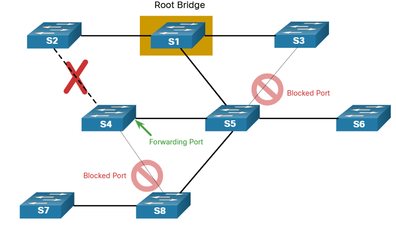

STP prevents loops from occurring by configuring a loop-free path through the network using strategically placed "blocking-state" ports. The switches running STP are able to compensate for failures by dynamically unblocking the previously blocked ports and permitting traffic to traverse the alternate paths.

# 5.2 STP Operations 

## 5.2.1 Steps to a Loop-Free Topology

Now you know how loops are created and the basics of using spanning tree protocol to prevent them. This topic will take you, step by step, through the operation of STP. Using the STA, STP builds a loop-free topology in a four-step process:
1. Elect the root bridge.
2. Elect the root ports.
3. Elect designated ports.
4. Elect alternate (blocked) ports.
During STA and STP functions, switches use Bridge Protocol Data Units (BPDUs) to share information about themselves and their connections. BPDUs are used to elect the root bridge, root ports, designated ports, and alternate ports. Each BPDU contains a bridge ID (BID) that identifies which switch sent the BPDU. The BID is involved in making many of the STA decisions including root bridge and port roles. As shown in the figure, the BID contains a priority value, an extended system ID, and the MAC address of the switch. The lowest BID value is determined by the combination of these three fields.

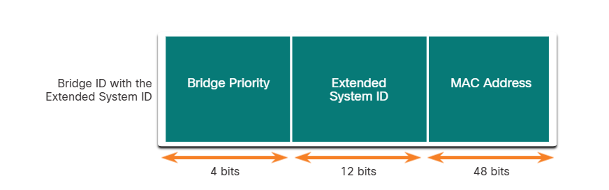

The BID includes the Bridge Priority, the Extended System ID, and the MAC Address of the switch.

### Bridge Priority

The default priority value for all Cisco switches is the decimal value 32768. The range is 0 to 61440 in increments of 4096. A lower bridge priority is preferable. A bridge priority of 0 takes precedence over all other bridge priorities.

### Extended System ID

The extended system ID value is a decimal value added to the bridge priority value in the BID to identify the VLAN for this BPDU.

Early implementations of IEEE 802.1D were designed for networks that did not use VLANs. There was a single common spanning tree across all switches. For this reason, in older switches, the extended system ID was not included in the BPDUs. As VLANs became common for network infrastructure segmentation, 802.1D was enhanced to include support for VLANs, which required that the 12-bit VLAN ID be included in the BPDU frame. VLAN information is included in the BPDU frame through the use of the extended system ID.

The extended system ID allows later implementations of STP to have different root bridges for different sets of VLANs. This can allow for redundant, non-forwarding links in a STP topology for one set of VLANs to be used by a different set of VLANs using a different root bridge.

### MAC address

When two switches are configured with the same priority and have the same extended system ID, the switch having the MAC address with the lowest value, expressed in hexadecimal, will have the lower BID.

## 5.2.2 1. Elect the Root Bridge

The STA designates a single switch as the root bridge and uses it as the reference point for all path calculations. Switches exchange BPDUs to build the loop-free topology beginning with selecting the root bridge.

An election process determines which switch becomes the root bridge. All switches in the broadcast domain participate in the election process. After a switch boots, it begins to send out BPDU frames every two seconds. These BPDU frames contain the BID of the sending switch and the BID of the root bridge, known as the Root ID.

The switch with the lowest BID will become the root bridge. At first, all switches declare themselves as the root bridge with their own BID set as the Root ID. Eventually, the switches learn through the exchange of BPDUs which switch has the lowest BID and will agree on one root bridge.

In the figure, S1 is elected the root bridge because it has the lowest BID.

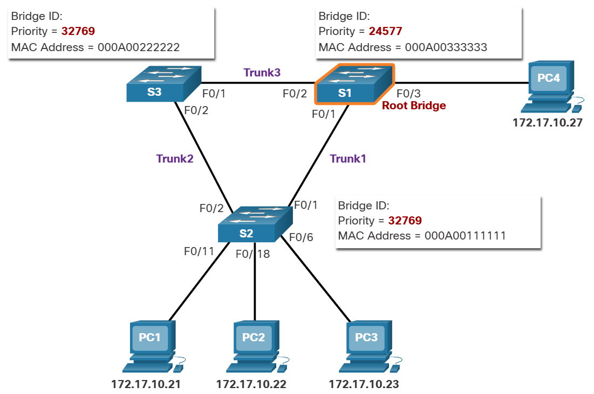

## 5.2.3 Impact of Default BIDs

Because the default priority is 32768, it is possible for two or more switches to have the same priority. In this scenario, where the priorities are the same, the switch with the lowest MAC address will become the root bridge. To ensure that the root bridge decision best meets network requirements, it is recommended that the administrator configure the desired root bridge switch with a lower priority.

In the figure, all switches are configured with the same priority of 32769. Here the MAC address becomes the deciding factor as to which switch becomes the root bridge. The switch with the lowest hexadecimal MAC address value is the preferred root bridge. In this example, S2 has the lowest value for its MAC address and is elected as the root bridge for that spanning tree instance.

**Note:** In the example, the priority of all the switches is 32769. The value is based on the 32768 default bridge priority and the extended system ID (VLAN 1 assignment) associated with each switch (32768+1).

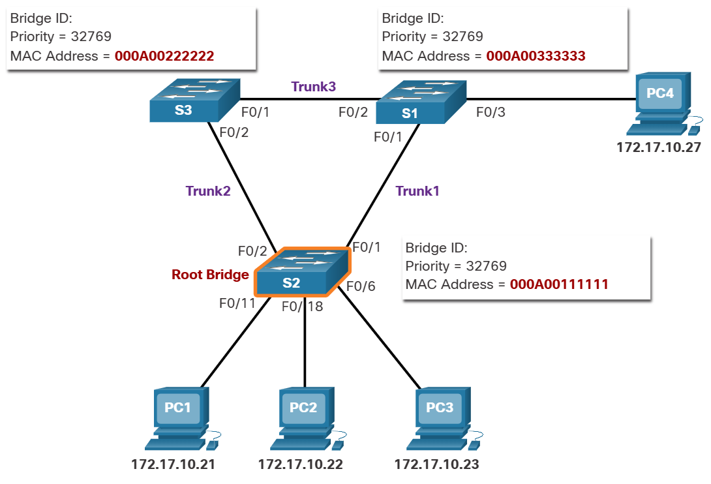

## 5.2.4 Determine the Root Path Cost

When the root bridge has been elected for a given spanning tree instance, the STA starts the process of determining the best paths to the root bridge from all destinations in the broadcast domain. The path information, known as the internal root path cost, is determined by the sum of all the individual port costs along the path from the switch to the root bridge.

Note: The BPDU includes the root path cost. This is the cost of the path from the sending switch to the root bridge.

When a switch receives the BPDU, it adds the ingress port cost of the segment to determine its internal root path cost.

The default port costs are defined by the speed at which the port operates. The table shows the default port costs suggested by IEEE. Cisco switches by default use the values as defined by the IEEE 802.1D standard, also known as the short path cost, for both STP and RSTP. However, the IEEE standard suggests using the values defined in the IEEE-802.1w, also known as long path cost, when using 10 Gbps links and faster.

Note: RSTP is discussed in more detail later in this module.

| Link Speed | STP Cost: IEEE 802.1D-1998 | RSTP Cost: IEEE 802.1w-2004 |
|---|---|---|
| 10 Gbps | 2 | 2,000 |
| 1 Gbps | 4 | 20,000 |
| 100 Mbps | 19 | 200,000 |
| 10 Mbps | 100 | 2,000,000 |

Although switch ports have a default port cost associated with them, the port cost is configurable. The ability to configure individual port costs gives the administrator the flexibility to manually control the spanning tree paths to the root bridge.

## 5.2.5 2. Elect the Root Ports

After the root bridge has been determined, the STA algorithm is used to select the root port. Every non-root switch will select one root port. The root port is the port closest to the root bridge in terms of overall cost (best path) to the root bridge. This overall cost is known as the internal root path cost.

The internal root path cost is equal to the sum of all the port costs along the path to the root bridge, as shown in the figure. Paths with the lowest cost become preferred, and all other redundant paths are blocked. In the example, the internal root path cost from S2 to the root bridge S1 over path 1 is 19 (based on the IEEE- specified individual port cost) while the internal root path cost over path 2 is 38. Because path 1 has a lower overall path cost to the root bridge, it is the preferred path and F0/1 becomes the root port on S2.

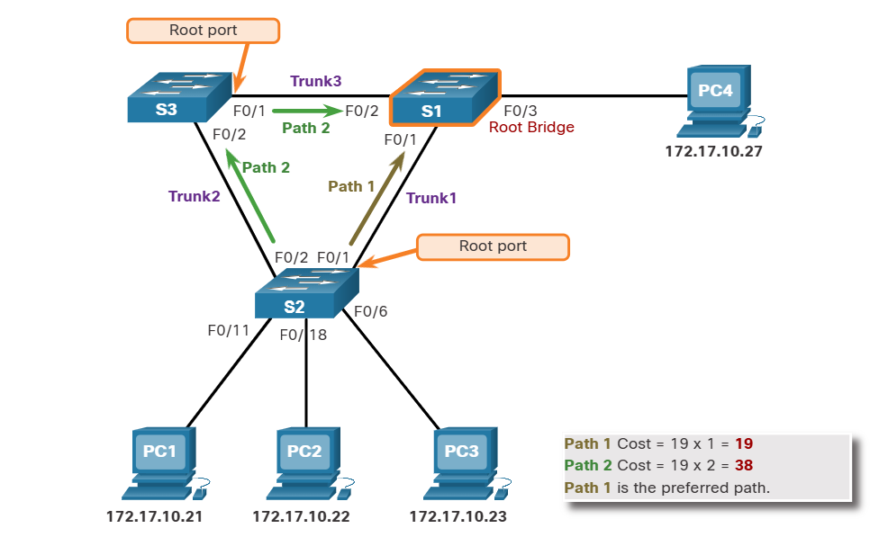

## 5.2.6 3. Elect Designated Ports

The loop prevention part of spanning tree becomes evident during these next two steps. After each switch selects a root port, the switches will then select designated ports.

Every segment between two switches will have one designated port. The designated port on the segment (with two switches) that has the LOWEST internal root path cost to the root bridge. In other words, the designated port has the best path to receive traffic leading to the root bridge.

What is not a root port or a designated port becomes an alternate or blocked port. The end result is a single path from every switch to the root bridge.

### Designated Ports on Root Bridge

All ports on the root bridge are designated ports, as shown in the figure. This is because the root bridge has the lowest cost to itself.

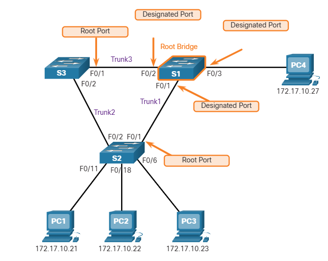

All the ports on the root bridge are designated ports.

### Designated Port When There is a Root Port

If one end of a segment is a root port, then the other end is a designated port. To demonstrate this, the figure shows that switch S4 is connected to S3. The FaO/1 interface on S4 is its root port because it has the best and only path to the root bridge. The Fa0/3 interface on S3 at the other end of the segment would therefore, be the designated port.

Note: All switch ports with end devices (hosts) attached are designated ports.

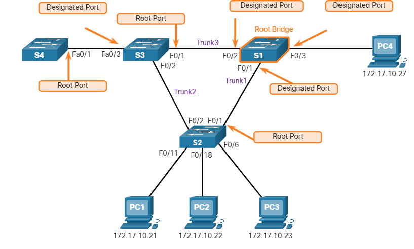

FaO/1 interface on S4 is a root port because the Fa0/3 interface of S3 is a designated port.

### Designated Port When There is No Root Port

This leaves only segments between two switches where neither of the switches is the root bridge. In this case, the port on the switch with the least-cost path to the root bridge is the designated port for the segment. For example, in the figure, the last segment is the one between S2 and S3. Both S2 and S3 have the same path cost to the root bridge. The spanning tree algorithm will use the bridge ID as a tie breaker. Although not shown in the figure, S2 has a lower BID. Therefore, the FO/2 port of S2 will be chosen as the designated port. Designated ports are in forwarding state.

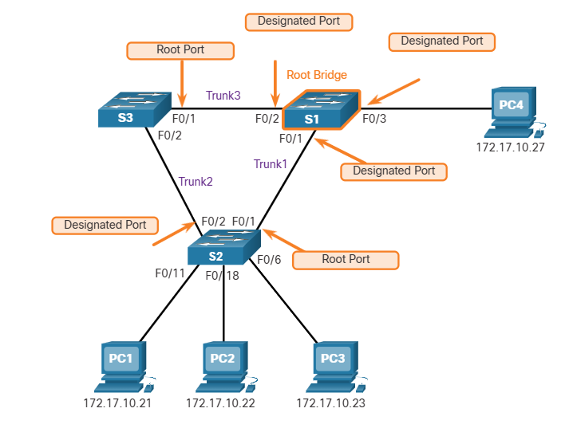

The Fa0/2 interface of S2 is the designated port on the segment with S3.

## 5.2.7 4. Elect Alternate (Blocked) Ports

If a port is not a root port or a designated port, then it becomes an alternate (or backup) port. Alternate ports and backup ports are in discarding or blocking state to prevent loops. In the figure, the STA has configured port F0/2 on S3 in the alternate role. Port F0/2 on S3 is in the blocking state and will not forward Ethernet frames. All other inter-switch ports are in forwarding state. This is the loop- prevention part of STP.

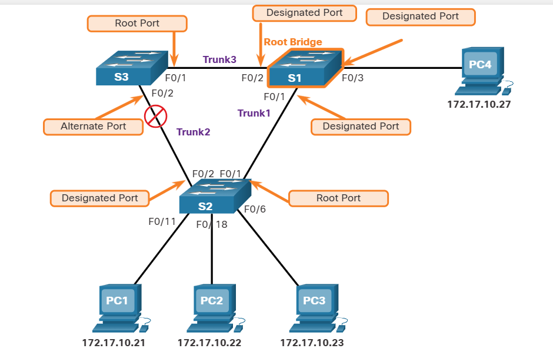

The Fa0/2 interface of S3 is not a root port or a designated port, so it becomes an alternate or blocked port.

## 5.2.8 Elect a Root Port from Multiple Equal-Cost Paths

Root port and designated ports are based on the lowest path cost to the root bridge. But what happens if the switch has multiple equal- cost paths to the root bridge? How does a switch designate a root port?

When a switch has multiple equal-cost paths to the root bridge, the switch will determine a port using the following criteria:
1. Lowest sender BID
2. Lowest sender port priority
3. Lowest sender port ID

### 1. Lowest Sender BID

The figure shows a topology with four switches, including switch S1 as the root bridge. Examining the port roles, port F0/1 on switch S3 and port F0/3 on switch S4 have been selected as root ports because they have the lowest cost path (root path cost) to the root bridge for their respective switches. S2 has two ports, F0/1 and F0/2 with equal cost paths to the root bridge. In this case the bridge IDs of the neighboring switches, S3 and S4, will be used to break the tie. This is known as the sender's BID. S3 has a BID of 32769.5555.5555.5555 and S4 has a BID of 32769.1111.1111.1111. Because S4 has a lower BID, the F0/1 port of S2, which is the port connected to S4, will be the root port.

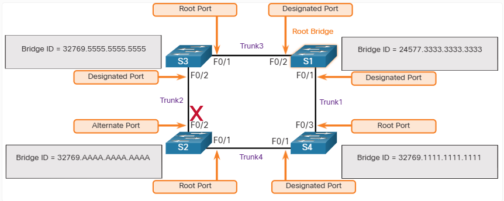

### 2. Lowest Sender Port Priority

To demonstrate these next two criteria, the topology is changed to one where two switches are connected with two equal-cost paths between them. S1 is the root bridge, so both of its ports are designated ports.

S4 has two ports with equal-cost paths to the root bridge. Because both ports are connected to the same switch, the sender's BID (S1) is equal. So the first step is a tie.

Next on the list is the sender's (S1) port priority. The default port priority is 128, so both ports on S1 have the same port priority. This is also a tie. However, if either port on S1 was configured with a lower port priority, S4 would put its adjacent port in forwarding state. The other port on S4 would be a blocking state.

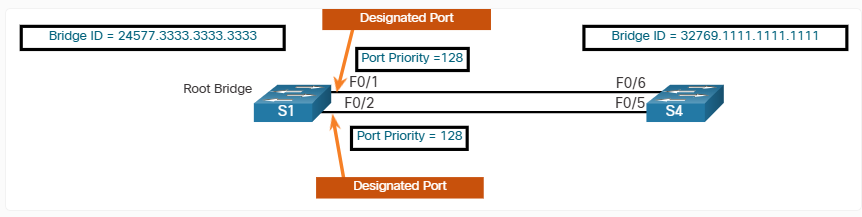

### 3. Lowest Sender Port ID

The last tie-breaker is the lowest sender's port ID. Switch S4 has received BPDUs from port F0/1 and port F0/2 on S1. Remember the decision is based on the sender's port ID, not the receiver's port ID. Because the port ID of FO/1 on S1 is lower than port F0/2, the port FO/6 on switch S4 will be the root port. This is the port on S4 that is connected to the F0/1 port on S1.

Port FO/5 on S4 will become an alternate port and placed in the blocking state, which is the loop-prevention part of STP.

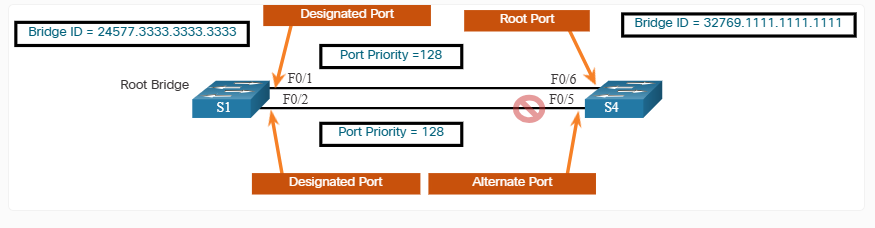

## 5.2.9 STP Timers and Port States

STP convergence requires three timers, as follows:
    • Hello Timer -The hello time is the interval between BPDUs. The default is 2 seconds but can be modified to between 1 and 10 seconds.
    • Forward Delay Timer -The forward delay is the time that is spent in the listening and learning state. The default is 15 seconds but can be modified to between 4 and 30 seconds.
    • Max Age Timer -The max age is the maximum length of time that a switch waits before attempting to change the STP topology. The default is 20 seconds but be modified to between 6 and 40 seconds.

Note: The default times can be changed on the root bridge, which dictates the value of these timers for the STP domain.

STP facilitates the logical loop-free path throughout the broadcast domain. The spanning tree is determined through the information learned by the exchange of the BPDU frames between the interconnected switches. If a switch port transitions directly from the blocking state to the forwarding state without information about the full topology during the transition, the port can temporarily create a data loop.

For this reason, STP has five ports states, four of which are operational port states as shown in the figure. The disabled state is considered non-operational.

Note: To avoid problems with STP, IEEE recommends a maximum diameter of seven switches when using the default STP timers.

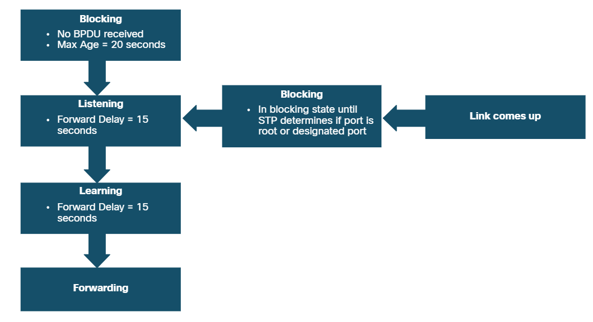

The details of each port state are shown in the table.

| Port State | Description |
|---|---|
| Blocking | The port is an alternate port and does not participate in frame forwarding. The port receives BPDU frames to determine the location and root ID of the root bridge. BPDU frames also determine which port roles each switch port should assume in the final active STP topology. With a Max Age timer of 20 seconds, a switch port that has not received an expected BPDU from a neighbor switch will go into the blocking state. |
| Listening | After the blocking state, a port will move to the listening state. The port receives BPDUs to determine the path to the root. The switch port also transmits its own BPDU frames and informs adjacent switches that the switch port is preparing to participate in the active topology. |
| Learning | A switch port transitions to the learning state after the listening state. During the learning state, the switch port receives and processes BPDUs and prepares to participate in frame forwarding. It also begins to populate the MAC address table. However, in the learning state, user frames are not forwarded to the destination. |
| Forwarding | In the forwarding state, a switch port is considered part of the active topology. The switch port forwards user traffic and sends and receives BPDU frames. |
| Disabled | A switch port in the disabled state does not participate in spanning tree and does not forward frames. The disabled state is set when the switch port is administratively disabled. |

## 5.2.10 Operational Details of Each Port State

The table summarizes the operational details of each port state. 

| Port State | BPDU | MAC Address Table | Forwarding Data Frames |
|---|---|---|---|
| Blocking | Receive only | No update | No |
| Listening | Receive and send | No update | No |
| Learning | Receive and send | Updating table | No |
| Forwarding | Receive and send | Updating table | Yes |
| Disabled | None sent or received | No update | No |

## 5.2.11 Per-VLAN Spanning Tree

Up until now, we have discussed STP in an environment where there is only one VLAN. However, STP can be configured to operate in an environment with multiple VLANs.

In Per-VLAN Spanning Tree (PVST) versions of STP, there is a root bridge elected for each spanning tree instance. This makes it possible to have different root bridges for different sets of VLANs. STP operates a separate instance of STP for each individual VLAN. If all ports on all switches are members of VLAN 1, then there is only one spanning tree instance.

# 5.3 Evolution of STP

## 5.3.1 Different Versions of STP

This topic details the many different versions of STP and other options for preventing loops in your network.

Up to now, we have used the term Spanning Tree Protocol and the acronym STP, which can be misleading. Many professionals generically use these to refer to the various implementations of spanning tree, such as Rapid Spanning Tree Protocol (RSTP) and Multiple Spanning Tree Protocol (MSTP). In order to communicate spanning tree concepts correctly, it is important to refer to the implementation or standard of spanning tree in context.

The latest standard for spanning tree is contained in IEEE-802-1D-2004, the IEEE standard for Local and metropolitan area networks:Media Access Control (MAC) Bridges. This version of the standard states that switches and bridges that comply with the standard will use Rapid Spanning Tree Protocol (RSTP) instead of the older STP protocol specified in the original 802.1d standard. In this curriculum, when the original Spanning Tree Protocol is the context of a discussion, the phrase "original 802.1D spanning tree" is used to avoid confusion. Because the two protocols share much of the same terminology and methods for the loop-free path, the primary focus will be on the current standard and the Cisco proprietary implementations of STP and RSTP.

Several varieties of spanning tree protocols have emerged since the original IEEE 802.1D specification, as shown in the table.

| STP Variety | Description |
|---|---|
| STP | This is the original IEEE 802.1D version (802.1D-1998 and earlier) that provides a loop-free topology in a network with redundant links. Also called Common Spanning Tree (CST), it assumes one spanning tree instance for the entire bridged network, regardless of the number of VLANs. |
| PVST+ | Per-VLAN Spanning Tree (PVST+) is a Cisco enhancement of STP that provides a separate 802.1D spanning tree instance for each VLAN configured in the network. PVST+ supports PortFast, UplinkFast, BackboneFast, BPDU guard, BPDU filter, root guard, and loop guard. |
| RSTP | Rapid Spanning Tree Protocol (RSTP) or IEEE 802.1w is an evolution of STP that provides faster convergence than STP. |
| 802.1D-2004 | This is an updated version of the STP standard, incorporating IEEE 802.1w. |
| Rapid PVST+ | This is a Cisco enhancement of RSTP that uses PVST+ and provides a separate instance of 802.1w per VLAN. Each separate instance supports PortFast, BPDU guard, BPDU filter, root guard, and loop guard. |
| MSTP | Multiple Spanning Tree Protocol (MSTP) is an IEEE standard inspired by the earlier Cisco proprietary Multiple Instance STP (MISTP) implementation. MSTP maps multiple VLANs into the same spanning tree instance. |
| MST | Multiple Spanning Tree (MST) is the Cisco implementation of MSTP, which provides up to 16 instances of RSTP and combines many VLANs with the same physical and logical topology into a common RSTP instance. Each instance supports PortFast, BPDU guard, BPDU filter, root guard, and loop guard. |

A network professional, whose duties include switch administration, may be required to decide which type of spanning tree protocol to implement.

Cisco switches running IOS 15.0 or later, run PVST+ by default. This version incorporates many of the specifications of IEEE 802.1D- 2004, such as alternate ports in place of the former non-designated ports. Switches must be explicitly configured for rapid spanning tree mode in order to run the rapid spanning tree protocol.

## 5.3.2 RSTP Concepts

RSTP (IEEE 802.1w) supersedes the original 802.1D while retaining backward compatibility. The 802.1w STP terminology remains primarily the same as the original IEEE 802.1D STP terminology. Most parameters have been left unchanged. Users that are familiar with the original STP standard can easily configure RSTP. The same spanning tree algorithm is used for both STP and RSTP to determine port roles and topology.

RSTP increases the speed of the recalculation of the spanning tree when the Layer 2 network topology changes. RSTP can achieve much faster convergence in a properly configured network, sometimes in as little as a few hundred milliseconds. If a port is configured to be an alternate port it can immediately change to a forwarding state without waiting for the network to converge.

**Note:** Rapid PVST+ is the Cisco implementation of RSTP on a per-VLAN basis. With Rapid PVST+ an independent instance of RSTP runs for each VLAN.

## 5.3.3 RSTP Port States and Port Roles

The port states and port roles between STP and RSTP are similar.

### STP and RSTP Port States

As shown in the figure, there are only three port states in RSTP that correspond to the three possible operational states in STP. The 802.1D disabled, blocking, and listening states are merged into a unique 802.1w discarding state.

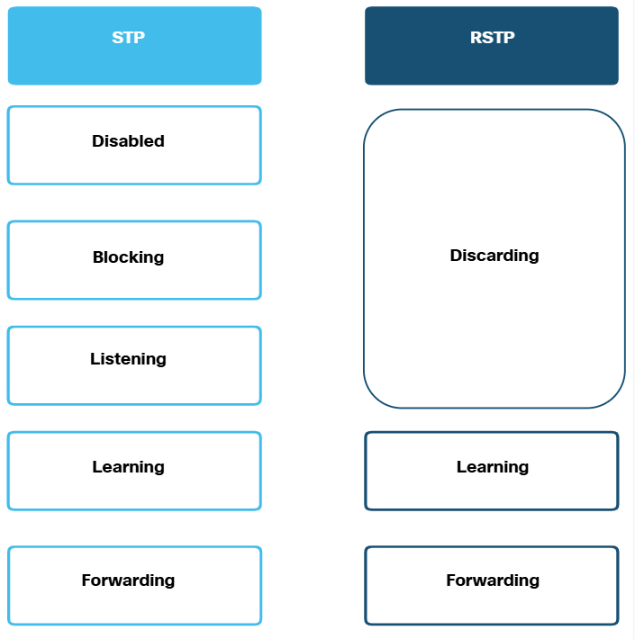

### STP and RSTP Port Roles

As shown in the figure, root ports and designated ports are the same for both STP and RSTP. However, there are two RSTP port roles that correspond to the blocking state of STP. In STP, a blocked port is defined as not being the designated or root port. RSTP has two port roles for this purpose.

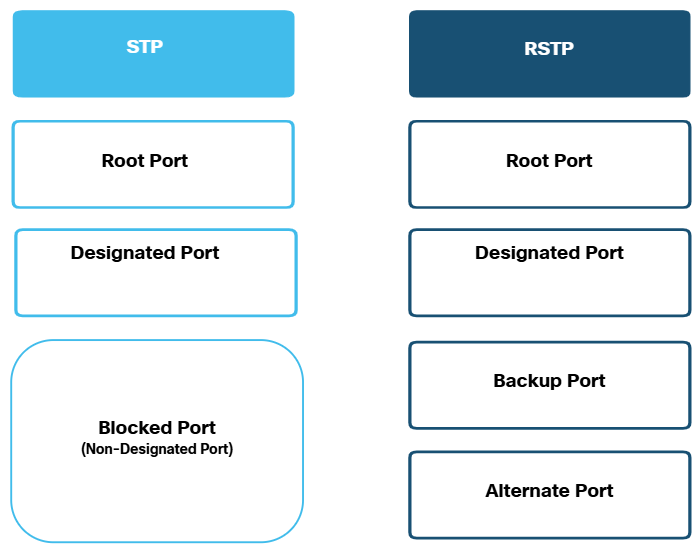

### RSTP Alternate and Backup Ports

As shown in the figure, the alternate port has an alternate path to the root bridge. The backup port is a backup to a shared medium, such as a hub. A backup port is less common because hubs are now considered legacy devices.

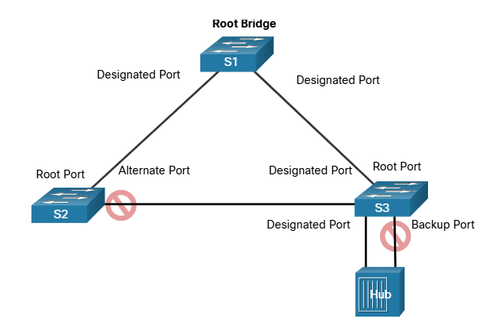

## 5.3.4 PortFast and BPDU Guard

When a device is connected to a switch port or when a switch powers up, the switch port goes through both the listening and learning states, each time waiting for the Forward Delay timer to expire. This delay is 15 seconds for each state, listening and learning, for a total of 30 seconds. This delay can present a problem for DHCP clients trying to discover a DHCP server. DHCP messages from the connected host will not be forwarded for the 30 seconds of Forward Delay timers and the DHCP process may timeout. The result is that an IPv4 client will not receive a valid IPv4 address.

**Note:** Although this may occur with clients sending ICMPv6 Router Solicitation messages, the router will continue to send ICMPv6 Router Advertisement messages so the device will know how to obtain its address information.

When a switch port is configured with PortFast, that port transitions from blocking to forwarding state immediately, bypassing the usual 802.1D STP transition states (the listening and learning states) and avoiding a 30 second delay. You can use PortFast on access ports to allow devices connected to these ports, such as DHCP clients, to access the network immediately, rather than waiting for IEEE 802.1D STP to converge on each VLAN. Because the purpose of PortFast is to minimize the time that access ports must wait for spanning tree to converge, it should only be used on access ports. If you enable PortFast on a port connecting to another switch, you risk creating a spanning tree loop. PortFast is only for use on switch ports that connect to end devices.

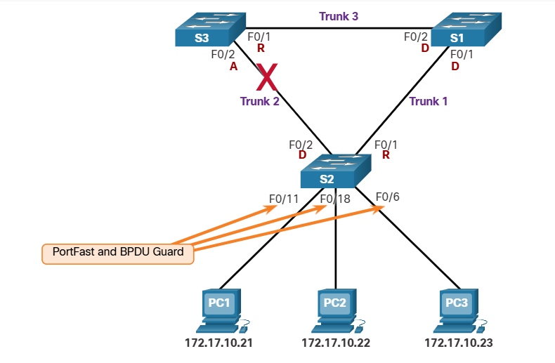

In a valid PortFast configuration, BPDUs should never be received on PortFast-enabled switch ports because that would indicate that another bridge or switch is connected to the port. This potentially causes a spanning tree loop. To prevent this type of scenario from occurring, Cisco switches support a feature called BPDU guard. When enabled, BPDU guard immediately puts the switch port in an errdisabled (error-disabled) state on receipt of any BPDU. This protects against potential loops by effectively shutting down the port. The BPDU guard feature provides a secure response to invalid configurations because an administrator must manually put the interface back into service.

## 5.3.5 Alternatives to STP

STP was and still is an Ethernet loop-prevention protocol. Over the years, organizations required greater resiliency and availability in the LAN. Ethernet LANs went from a few interconnected switches connected to a single router, to a sophisticated hierarchical network design including access, distribution and core layer switches, as shown in the figure.

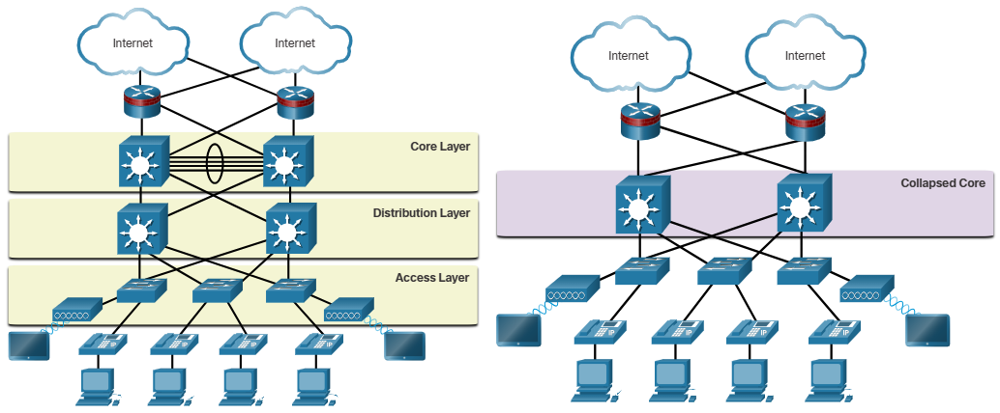

Depending on the implementation, Layer 2 may include not only the access layer, but also the distribution or even the core layers. These designs may include hundreds of switches, with hundreds or even thousands of VLANs. STP has adapted to the added redundancy and complexity with enhancements, as part of RSTP and MSTP.

An important aspect to network design is fast and predictable convergence when there is a failure or change in the topology. Spanning tree does not offer the same efficiencies and predictabilities provided by routing protocols at Layer 3. The figure shows a traditional hierarchical network design with the distribution and core multilayer switches performing routing.

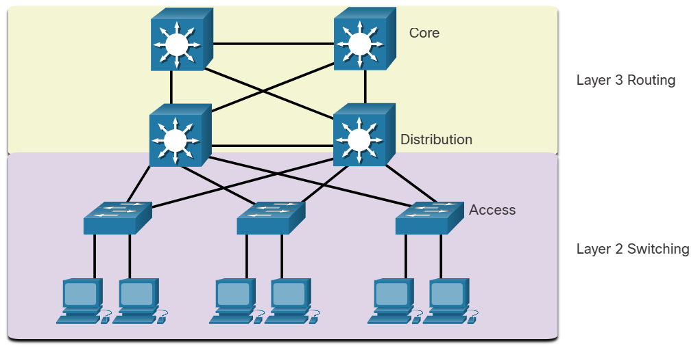

Layer 3 routing allows for redundant paths and loops in the topology, without blocking ports. For this reason, some environments are transitioning to Layer 3 everywhere except where devices connect to the access layer switch. In other words, the connections between access layer switches and distribution switches would be Layer 3 instead of Layer 2, as shown in the next figure.

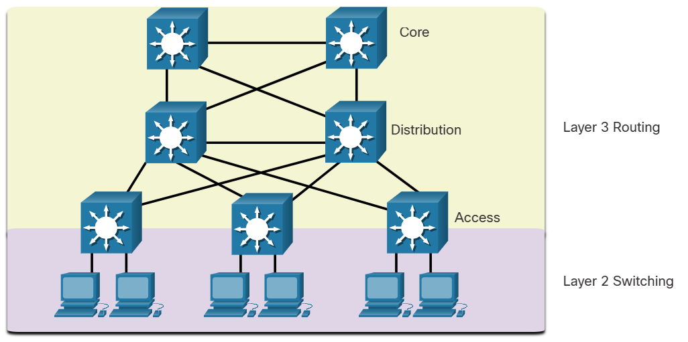

Although STP will most likely continue to be used as a loop prevention mechanism in the enterprise, on access layer switches, other
technologies are also being used, including the following:

* Multi System Link Aggregation (MLAG)
* Shortest Path Bridging (SPB)
* Transparent Interconnect of Lots of Links (TRILL)

**Note:** These technologies are beyond the scope of this course.

