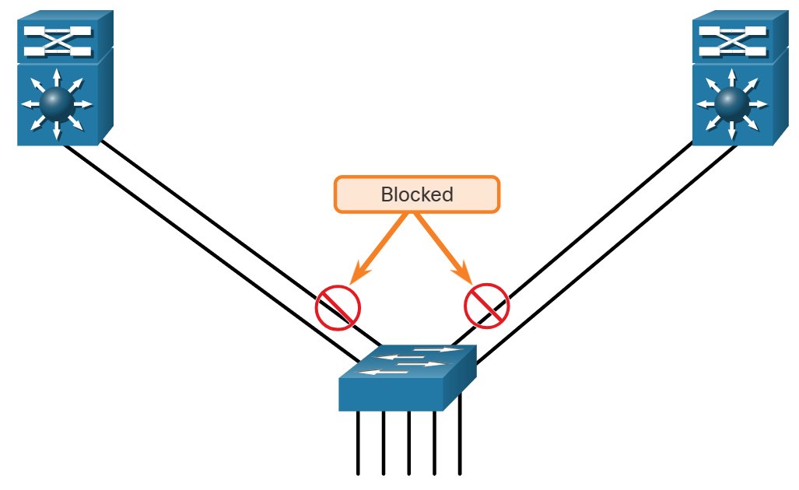
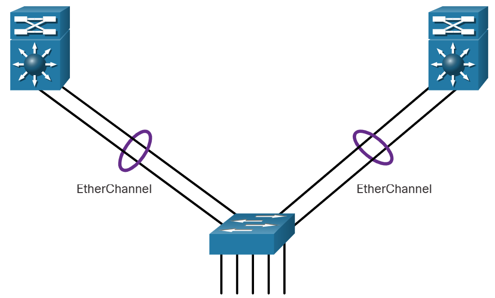
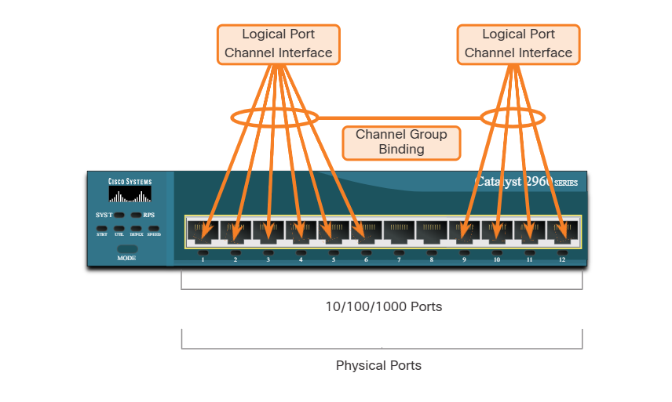
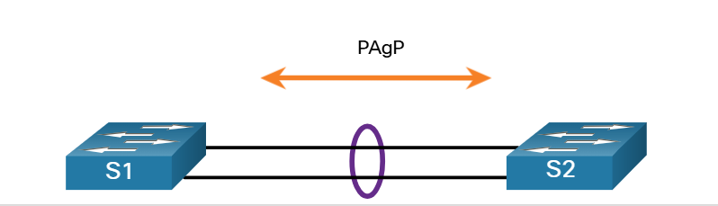
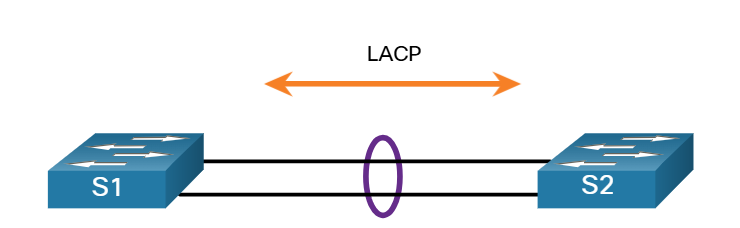
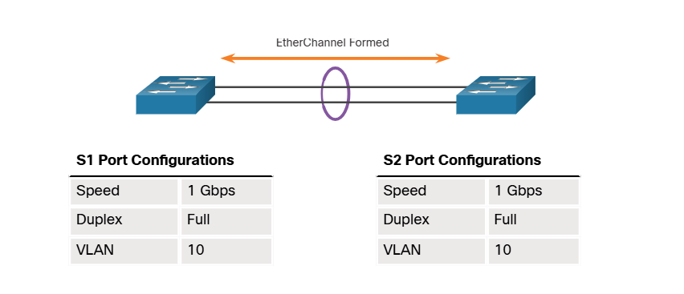
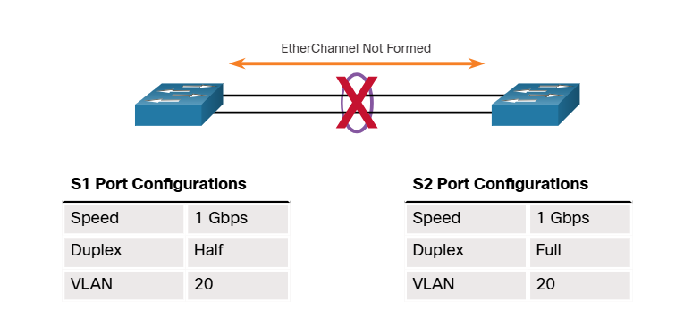
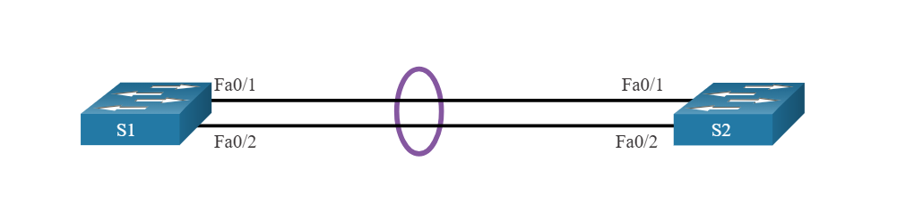

# Module 6: EtherChannel 

# 6.1 EtherChannel Operation 

## 6.1.1 Link Aggregation

There are scenarios in which more bandwidth or redundancy between devices is needed than what can be provided by a single link. Multiple links could be connected between devices to increase bandwidth. However, Spanning Tree Protocol (STP), which is enabled on Layer 2 devices like Cisco switches by default, will block redundant links to prevent switching loops, as shown in the figure.

A link aggregation technology is needed that allows redundant links between devices that will not be blocked by STP. That technology is known as EtherChannel.

EtherChannel is a link aggregation technology that groups multiple physical Ethernet links together into one single logical link. It is used to provide fault-tolerance, load sharing, increased bandwidth, and redundancy between switches, routers, and servers.

EtherChannel technology makes it possible to combine the number of physical links between the switches to increase the overall speed of switch-to-switch communication.



By default, STP will block redundant links.

## 6.1.2 EtherChannel

EtherChannel technology was originally developed by Cisco as a LAN switch-to-switch technique of grouping several Fast Ethernet or Gigabit Ethernet ports into one logical channel. When an EtherChannel is configured, the resulting virtual interface is called a port channel. The physical interfaces are bundled together into a port channel interface, as shown in the figure.



## 6.1.3 Advantages of EtherChannel

EtherChannel technology has many advantages, including the following:

* Most configuration tasks can be done on the EtherChannel interface instead of on each individual port, ensuring configuration consistency throughout the links.
* EtherChannel relies on existing switch ports. There is no need to upgrade the link to a faster and more expensive connection to have more bandwidth.
* Load balancing takes place between links that are part of the same EtherChannel. Depending on the hardware platform, one or more load-balancing methods can be implemented. These methods include source MAC and destination MAC load balancing, or source IP and destination IP load balancing, across the physical links.
* EtherChannel creates an aggregation that is seen as one logical link. When several EtherChannel bundles exist between two switches, STP may block one of the bundles to prevent switching loops. When STP blocks one of the redundant links, it blocks the entire EtherChannel. This blocks all the ports belonging to that EtherChannel link. Where there is only one EtherChannel link, all physical links in the EtherChannel are active because STP sees only one (logical) link.
* EtherChannel provides redundancy because the overall link is seen as one logical connection. Additionally, the loss of one physical link within the channel does not create a change in the topology. Therefore, a spanning tree recalculation is not required. Assuming at least one physical link is present; the EtherChannel remains functional, even if its overall throughput decreases because of a lost link within the EtherChannel.

## 6.1.4 Implementation Restrictions

EtherChannel implementation on the catalyst 2960 switch has certain implementation restrictions, including the following:

• Interface types cannot be mixed. For example, Fast Ethernet and Gigabit Ethernet cannot be mixed within a single EtherChannel.
• Currently each EtherChannel can consist of up to eight compatibly-configured Ethernet ports. EtherChannel provides full-duplex bandwidth up to 800 Mbps (Fast EtherChannel) or 8 Gbps (Gigabit EtherChannel) between one switch and another switch or host.
• The Cisco Catalyst 2960 Layer 2 switch currently supports up to six EtherChannels. However, as new IOSs are developed and platforms change, some cards and platforms may support increased numbers of ports within an EtherChannel link, as well as support an increased number of Gigabit EtherChannels.
• The individual EtherChannel group member port configuration must be consistent on both devices. If the physical ports of one side are configured as trunks, the physical ports of the other side must also be configured as trunks within the same native VLAN. Additionally, all ports in each EtherChannel link must be configured as Layer 2 ports.
• Each EtherChannel has a logical port channel interface, as shown in the figure. A configuration applied to the port channel interface affects all physical interfaces that are assigned to that interface.



## 6.1.5 AutoNegotiation Protocols

EtherChannels can be formed through negotiation using one of two protocols, Port Aggregation Protocol (PAgP) or Link Aggregation Control Protocol (LACP). These protocols allow ports with similar characteristics to form a channel through dynamic negotiation with adjoining switches.

Note: It is also possible to configure a static or unconditional EtherChannel without PAgP or LACP.

## 6.1.6 PAgP Operation

PAgP (pronounced "Pag - P") is a Cisco-proprietary protocol that aids in the automatic creation of EtherChannel links. When an EtherChannel link is configured using PAgP, PAgP packets are sent between EtherChannel-capable ports to negotiate the forming of a channel. When PAgP identifies matched Ethernet links, it groups the links into an EtherChannel. The EtherChannel is then added to the spanning tree as a single port.

When enabled, PAgP also manages the EtherChannel. PAgP packets are sent every 30 seconds. PAgP checks for configuration consistency and manages link additions and failures between two switches. It ensures that when an EtherChannel is created, all ports have the same type of configuration.

Note: In EtherChannel, it is mandatory that all ports have the same speed, duplex setting, and VLAN information. Any port-channel modification after the creation of the channel also changes the aggregated channel ports.

PAgP helps create the EtherChannel link by detecting the configuration of each side and ensuring that links are compatible so that the EtherChannel link can be enabled when needed. The modes for PAgP as follows:

• On - This mode forces the interface to channel without PAgP. Interfaces configured in the on mode do not exchange PAgP packets.
• PAgP desirable - This PAgP mode places an interface in an active negotiating state in which the interface initiates negotiations with other interfaces by sending PAgP packets.
• PAgP auto - This PAgP mode places an interface in a passive negotiating state in which the interface responds to the PAgP packets that it receives but does not initiate PAgP negotiation.

The modes must be compatible on each side. If one side is configured to be in auto mode, it is placed in a passive state, waiting for the other side to initiate the EtherChannel negotiation. If the other side is also set to auto, the negotiation never starts and the EtherChannel does not form. If all modes are disabled by using the no command, or if no mode is configured, then the EtherChannel is disabled.

The on mode manually places the interface in an EtherChannel, without any negotiation. It works only if the other side is also set to on. If the other side is set to negotiate parameters through PAgP, no EtherChannel forms, because the side that is set to on mode does not negotiate.

No negotiation between the two switches means there is no checking to make sure that all the links in the EtherChannel are terminating on the other side, or that there is PAgP compatibility on the other switch.

## 6.1.7 PAgP Mode Settings Example

Consider the two switches in the figure. Whether S1 and S2 establish an EtherChannel using PAgP depends on the mode settings on each side of the channel.



The table shows the various combination of PAgP modes on S1 and S2 and the resulting channel establishment outcome.

### PAgP Modes

| S1      | S2             | Channel Establishment |
|---------|----------------|-----------------------|
| On      | On             | Yes                   |
| On      | Desirable/Auto | No                    |
| Desirable | Desirable    | Yes                   |
| Desirable | Auto         | Yes                   |
| Auto    | Desirable      | Yes                   |
| Auto    | Auto           | No                    |

## 6.1.8 LACP Operation

LACP is part of an IEEE specification (802.3ad) that allows several physical ports to be bundled to form a single logical channel. LACP allows a switch to negotiate an automatic bundle by sending LACP packets to the other switch. It performs a function similar to PAаGP with Cisco EtherChannel. Because LACP is an IEEE standard, it can be used to facilitate EtherChannels in multivendor environments. On Cisco devices, both protocols are supported.

**Note:** LACP was originally defined as IEEE 802.3ad. However, LACP is now defined in the newer IEEE 802.1AX standard for local and metropolitan area networks.

LACP provides the same negotiation benefits as PAаGP. LACP helps create the EtherChannel link by detecting the configuration of each side and making sure that they are compatible so that the EtherChannel link can be enabled when needed. The modes for LACP are as follows:

*   **On** - This mode forces the interface to channel without LACP. Interfaces configured in the on mode do not exchange LACP packets.
*   **LACP active** - This LACP mode places a port in an active negotiating state. In this state, the port initiates negotiations with other ports by sending LACP packets.
*   **LACP passive** - This LACP mode places a port in a passive negotiating state. In this state, the port responds to the LACP packets that it receives but does not initiate LACP packet negotiation.

Just as with PAаGP, modes must be compatible on both sides for the EtherChannel link to form. The on mode is repeated, because it creates the EtherChannel configuration unconditionally, without PAаGP or LACP dynamic negotiation.

LACP allows for eight active links, and also eight standby links. A standby link will become active should one of the current active links fail.

## 6.1.9 LACP Mode Settings Example

Consider the two switches in the figure. Whether S1 and S2 establish an EtherChannel using LACP depends on the mode settings on each side of the channel.



The table shows the various combination of LACP modes on S1 and S2 and the resulting channel establishment outcome.

| S1 | S2 | Channel Establishment |
|---|---|---|
| On | On | Yes |
| On | Active/Passive | No |
| Active | Active | Yes |
| Active | Passive | Yes |
| Passive | Active | Yes |
| Passive | Passive | No |


# 6.2 Configure EtherChannel 

## 6.2.1 Configuration Guidelines

Now that you know what EtherChannel is, this topic explains how to configure it. The following guidelines and restrictions are useful for configuring EtherChannel:

* **EtherChannel support** - All Ethernet interfaces must support EtherChannel with no requirement that interfaces be physically contiguous.
* **Speed and duplex** - Configure all interfaces in an EtherChannel to operate at the same speed and in the same duplex mode.
* **VLAN match** - All interfaces in the EtherChannel bundle must be assigned to the same VLAN or be configured as a trunk (shown in the figure).
* **Range of VLANs** - An EtherChannel supports the same allowed range of VLANs on all the interfaces in a trunking EtherChannel. If the allowed range of VLANs is not the same, the interfaces do not form an EtherChannel, even when they are set to **auto** or **desirable** mode.

The figure shows a configuration that would allow an EtherChannel to form between S1 and S2.



An EtherChannel is formed when configuration settings match on both switches.

In the next figure, S1 ports are configured as half duplex. Therefore, an EtherChannel will not form between S1 and S2.



An EtherChannel is not formed when configuration settings are different on each switch.

If these settings must be changed, configure them in port channel interface configuration mode. Any configuration that is applied to the port channel interface also affects individual interfaces. However, configurations that are applied to the individual interfaces do not affect the port channel interface. Therefore, making configuration changes to an interface that is part of an EtherChannel link may cause interface compatibility issues.

The port channel can be configured in access mode, trunk mode (most common), or on a routed port.

## 6.2.2 LACP Configuration Example

EtherChannel is disabled by default and must be configured. The topology in the figure will be used to demonstrate an EtherChannel configuration example using LACP.



Configuring EtherChannel with LACP requires the following three steps:

Step 1. Specify the interfaces that compose the EtherChannel group using the *interface range* *interface* global configuration mode command. The *range* keyword allows you to select several interfaces and configure them all together.

Step 2. Create the port channel interface with the *channel-group* *identifier* *mode* *active* command in interface range configuration mode. The identifier specifies a channel group number. The *mode active* keywords identify this as an LACP EtherChannel configuration.

Step 3. To change Layer 2 settings on the port channel interface, enter port channel interface configuration mode using the *interface* *port-channel* command, followed by the interface identifier. In the example, S1 is configured with an LACP EtherChannel. The port channel is configured as a trunk interface with the allowed VLANs specified.

```
S1(config)# interface range FastEthernet 0/1 - 2
S1(config-if-range)# channel-group 1 mode active
Creating a port-channel interface Port-channel 1
S1(config-if-range)# exit
S1(config)# interface port-channel 1
S1(config-if)# switchport mode trunk
S1(config-if)# switchport trunk allowed vlan 1,2,20
```

# 6.3 Verify and Troubleshoot EtherChannel

## 6.3.1 Verify EtherChannel

As always, when you configure devices in your network, you must verify your configuration. If there are problems, you will also need to be able to troubleshoot and fix them. This topic gives you the commands to verify, as well as some common EtherChannel network problems and their solutions.

The verification command examples will use the topology shown in the figure.


### show interfaces port-channel 

The show interfaces port-channel command displays the general status of the port channel interface. In the figure, the Port Channel 1 interface is up.

```
S1# show interfaces port-channel 1
Port-channel1 is up, line protocol is up (connected)
Hardware is EtherChannel, address is c07b.bcc4.a981 (bia c07b.bcc4.a981)
MTU 1500 bytes, BW 200000 Kbit/sec, DLY 100 usec,
reliability 255/255, txload 1/255, rxload 1/255
(output omitted)
```

### show etherchannel summary 

When several port channel interfaces are configured on the same device, use the show etherchannel summary command to display one line of information per port channel. In the output, the switch has one EtherChannel configured; group 1 uses LACP.

The interface bundle consists of the FastEthernet0/1 and FastEthernet0/2 interfaces. The group is a Layer 2 EtherChannel and it is in use, as indicated by the letters SU next to the port channel number.

```
S1# show etherchannel summary
Flags: D - down P - bundled in port-channel
       I - stand-alone s - suspended
       H - Hot-standby (LACP only) S - Layer2
       R - Layer3 U - in use N - not in use, no aggregation
       f - failed to allocate aggregator
       M - not in use, minimum links not met
       m - not in use, port not aggregated due to minimum links not met
       u - unsuitable for bundling
       w - waiting to be aggregated
       d - default port
       A - formed by Auto LAG
Number of channel-groups in use: 1
Number of aggregators: 1
Group Port-channel Protocol Ports
-----+------------+--------+------
1     Po1(SU)      LACP     Fa0/1(P)    Fa0/2(P)
```

## 6.3.2 Common Issues with EtherChannel Configurations

All interfaces within an EtherChannel must have the same configuration of speed and duplex mode, native and allowed VLANs on trunks, and access VLAN on access ports. Ensuring these configurations will significantly reduce network problems related to EtherChannel. Common EtherChannel issues include the following:

* Assigned ports in the EtherChannel are not part of the same VLAN, or not configured as trunks. Ports with different native VLANs cannot form an EtherChannel.
* Trunking was configured on some of the ports that make up the EtherChannel, but not all of them. It is not recommended that you configure trunking mode on individual ports that make up the EtherChannel. When configuring a trunk on an EtherChannel, verify the trunking mode on the EtherChannel.
* If the allowed range of VLANs is not the same, the ports do not form an EtherChannel even when PAgt is set to the auto or desirable mode.
* The dynamic negotiation options for PAgt and LACP are not compatibly configured on both ends of the EtherChannel.

**Note:** It is easy to confuse PAgt or LACP with DTP, because they are all protocols used to automate behavior on trunk links. PAgt and LACP are used for link aggregation (EtherChannel). DTP is used for automating the creation of trunk links. When an EtherChannel trunk is configured, typically EtherChannel (PAgt or LACP) is configured first and then DTP.

## 6.3.3 Troubleshoot EtherChannel Example

In the figure, interfaces F0/1 and F0/2 on switches S1 and S2 are connected with an EtherChannel. However, the EtherChannel is not operational.


### Step 1. View the EtherChannel Summary Information

The output of the **show etherchannel summary** command indicates that the EtherChannel is down.

```
S1# show etherchannel summary
Flags: D - down P - bundled in port-channel
       I - stand-alone s - suspended
       H - Hot-standby (LACP only)
       R - Layer3 S - Layer2
       U - in use N - not in use, no aggregation
       f - failed to allocate aggregator
       M - not in use, minimum links not met
       m - not in use, port not aggregated due to minimum links not met
       u - unsuitable for bundling
       w - waiting to be aggregated
       d - default port
       A - formed by Auto LAG
Number of channel-groups in use: 1
Number of aggregators: 1
Group Port-channel Protocol Ports
+-+-+-+-+-+-+-+-+-+-+-+-+-+-+-+-+-+-+-+-+-+-+-+-+-+-+-+-+-+-+-+-+
1      Po1(SD)      -        Fa0/1(D) Fa0/2(D)
```

### Step 2. View Port Channel Configuration

In the show run | begin interface port-channel output, more detailed output indicates that there are incompatible PAgP modes configured on S1 and S2.

```
S1# show run | begin interface port-channel
interface Port-channel1
 switchport trunk allowed vlan 1,2,20
 switchport mode trunk
!
interface FastEthernet0/1
 switchport trunk allowed vlan 1,2,20
 switchport mode trunk
 channel-group 1 mode on
!
interface FastEthernet0/2
 switchport trunk allowed vlan 1,2,20
 switchport mode trunk
 channel-group 1 mode on
========================================
S2# show run | begin interface port-channel
interface Port-channel1
 switchport trunk allowed vlan 1,2,20
 switchport mode trunk
!
interface FastEthernet0/1
 switchport trunk allowed vlan 1,2,20
 switchport mode trunk
 channel-group 1 mode desirable
!
interface FastEthernet0/2
 switchport trunk allowed vlan 1,2,20
 switchport mode trunk
 channel-group 1 mode desirable

```

### Step 3. Correct the Misconfiguration

To correct the issue, the PAgP mode on the EtherChannel is changed to desirable.

**Note:** EtherChannel and STP must interoperate. For this reason, the order in which EtherChannel-related commands are entered is important, which is why you see interface Port-Channel 1 removed and then re-added with the **channel-group** command, as opposed to directly changed. If one tries to change the configuration directly, STP errors cause the associated ports to go into blocking or errdisabled state.

```
S1(config)# no interface port-channel 1
S1(config)# interface range fa0/1 - 2
S1(config-if-range)# channel-group 1 mode desirable
Creating a port-channel interface Port-channel 1
S1(config-if-range)# no shutdown
S1(config-if-range)# exit
S1(config)# interface port-channel 1
S1(config-if)# switchport mode trunk
S1(config-if)# end
S1#
```

### Step 4. Verify EtherChannel is Operational

The EtherChannel is now active as verified by the output of the show etherchannel summary command.

```
S1# show etherchannel summary
Flags: D - down P - bundled in port-channel
       I - stand-alone s - suspended
       H - Hot-standby (LACP only)
       R - Layer3 S - Layer2
       U - in use N - not in use, no aggregation
       f - failed to allocate aggregator
       M - not in use, minimum links not met
       m - not in use, port not aggregated due to minimum links not met
       u - unsuitable for bundling
       w - waiting to be aggregated
       d - default port
       A - formed by Auto LAG

Number of channel-groups in use: 1
Number of aggregators: 1
Group Port-channel Protocol Ports
------+-------------+-----------+--------------------------------------------------
1      Po1(SU)      PAgP      Fa0/1(P)  Fa0/2(P)
```


