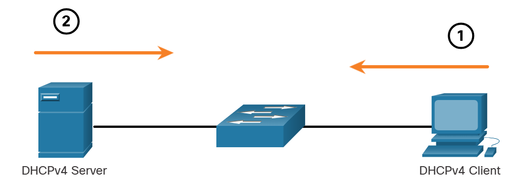
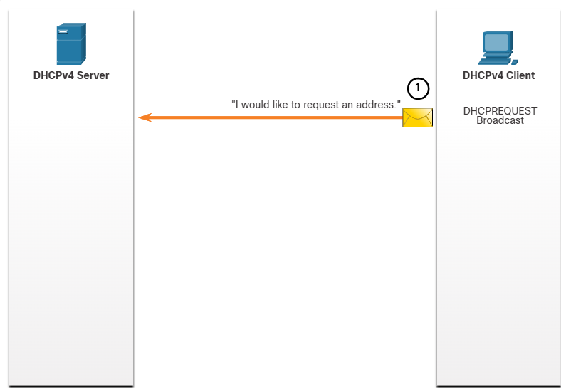
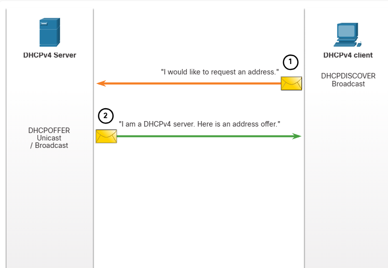
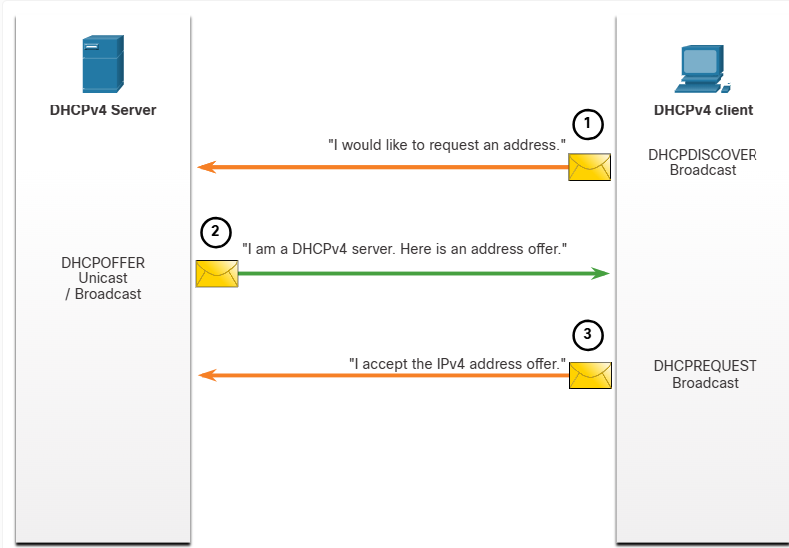
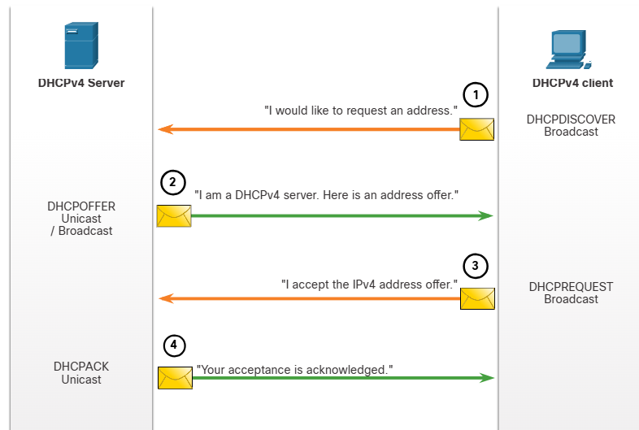
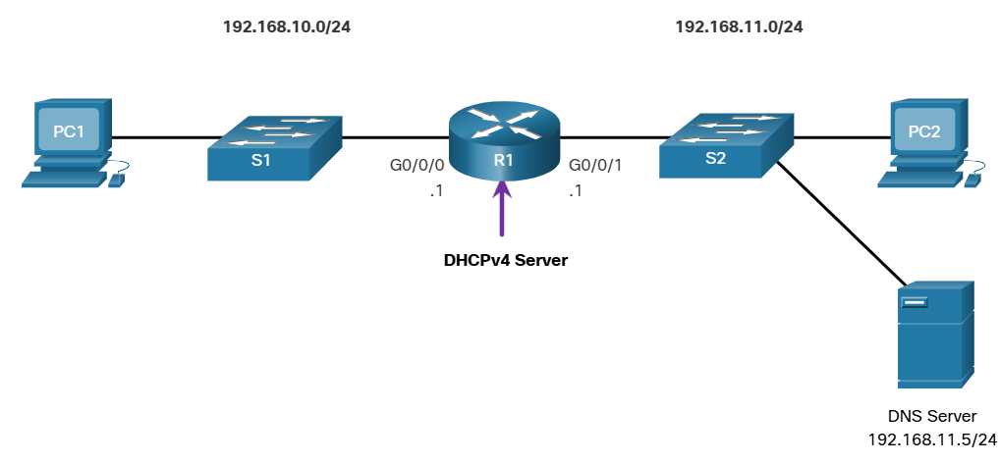
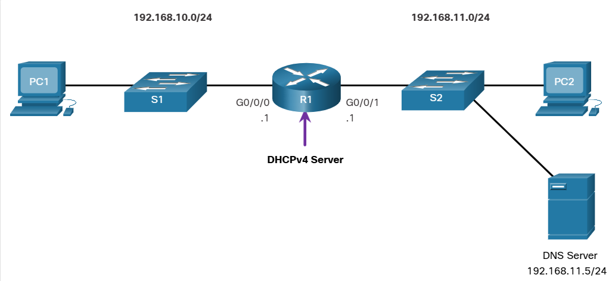
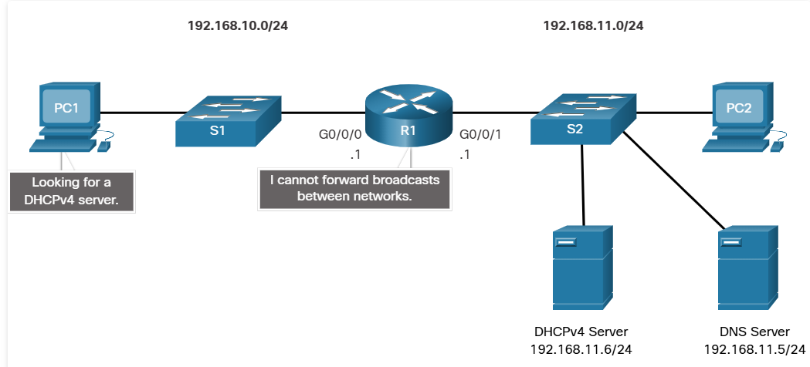
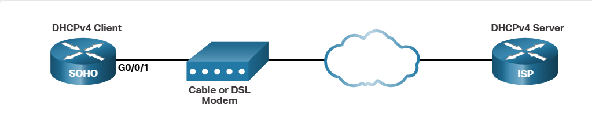
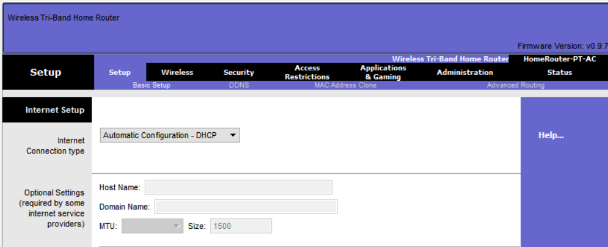

# Module 7: DHCPv4

# 7.1 DHCPv4 Concepts

## 7.1.1 DHCPv4 Server and Client

Dynamic Host Configuration Protocol 4 (DHCPv4) assigns IPv4 addresses and other network configuration information dynamically. Because desktop clients typically make up the bulk of network nodes, DCPv4 is an extremely useful and timesaving tool for network administrators.

A dedicated DHCPv4 server is scalable and relatively easy to manage. However, in a small branch or SOHO location, a Cisco router can be configured to provide DHCPv4 services without the need for a dedicated server. Cisco IOS software supports an optional, full- featured DHCPv4 server.

The DHCPv4 server dynamically assigns, or leases, an Pv4 address from a pool of addresses for a limited period of time chosen by the server, or until the client no longer needs the address. Clients lease the information from the server for an administratively defined period. Administrators configure DHCPv4 servers to set the leases to time out at different intervals. The lease is typically anywhere from 24 hours to a week or more. When the lease expires, the client must ask for another address, although the client is typically reassigned the same address.


1. The DHCPv4 lease process begins with the client sending a message requesting the services of a DHCP server.
2. If there is a DHCPv4 server that receives the message, it will respond with an IPv4 address and possible other network configuration information.

## 7.1.2 DHCPv4 Operation

DHCPv4 works in a client/server mode. When a client communicates with a DHCPv4 server, the server assigns or leases an IPv4 address to that client. The client connects to the network with that leased IPv4 address until the lease expires. The client must contact the DHCP server periodically to extend the lease. This lease mechanism ensures that clients that move or power off do not keep addresses that they no longer need. When a lease expires, the DHCP server returns the address to the pool where it can be reallocated as necessary.

## 7.1.3 Steps to Obtain a Lease
When the client boots (or otherwise wants to join a network), it begins a four-step process to obtain a lease:
1. DHCP Discover (DHCPDISCOVER)
2. DHCP Offer (DHCPOFFER)
3. DHCP Request (DHCPREQUEST)
4. DHCP Acknowledgment (DHCPACK)

### Step 1. DHCP Discover (DHCPDISCOVER)

The client starts the process using a broadcast DHCPDISCOVER message with its own MAC address to discover available DHCPv4 servers. Because the client has no valid IPv4 information at bootup, it uses Layer 2 and Layer 3 broadcast addresses to communicate with the server. The purpose of the DHCPDISCOVER message is to find DHCPv4 servers on the network.



### Step 2. DHCP Offer (DHCPOFFER)

When the DHCPv4 server receives a DHCPDISCOVER message, it reserves an available IPv4 address to lease to the client. The server also creates an ARP entry consisting of the MAC address of the requesting client and the leased IPv4 address of the client. The DHCPv4 server sends the binding DHCPOFFER message to the requesting client.



### Step 3. DHCP Request (DHCPREQUEST)

When the client receives the DHCOFFER from the server, it sends back a DHCPREQUEST message. This message is used for both lease origination and lease renewal. When used for lease origination, the DHCPREQUEST serves as a binding acceptance notice to the selected server for the parameters it has offered and an implicit decline to any other servers that may have provided the client a binding offer.

Many enterprise networks use multiple DHCPv4 servers. The DHCPREQUEST message is sent in the form of a broadcast to inform this DHCPv4 server and any other DHCPv4 servers about the accepted offer.



### Step 4. DHCP Acknowledgment (DHCPACK)

On receiving the DHCPREQUEST message, the server may verify the lease information with an ICMP ping to that address to ensure it is not being used already, it will create a new ARP entry for the client lease, and reply with a DHCPACK message. The DHCPACK message is a duplicate of the DHCOFFER, except for a change in the message type field. When the client receives the DCPACK message, it logs the configuration information and may perform an ARP lookup for the assigned address. If there is no reply to the ARP, the client knows that the IPv4 address is valid and starts using it as its own.



## 7.1.4 Steps to Renew a Lease

Prior to lease expiration, the client begins a two-step process to renew the lease with the DHCPv4 server, as shown in the figure:

1. DHCP Request (DHCPREQUEST)

Before the lease expires, the client sends a DHCPREQUEST message directly to the DHCPv4 server that originally offered the IPv4 address. If a DHCPACK is not received within a specified amount of time, the client broadcasts another DHCPREQUEST so that one of the other DHCPv4 servers can extend the lease.

2. DHCP Acknowledgment (DHCPACK)

On receiving the DHCPREQUEST message, the server verifies the lease information by returning a DHCPACK.

Note: These messages (primarily the DHCOFFER and DHCPACK) can be sent as unicast or broadcast according to IET RFC 2131.


# 7.2 Configure a Cisco IOS DHCPv4 Server 

## 7.2.1 Cisco IOS DHCPv4 Server
Now you have a basic understanding of how DHCPv4 works and how it can make your job a bit easier. If you do not have a separate DHCPv4 server, this topic will show you how to configure a Cisco IOS router to act as one. A Cisco router running Cisco IOS software can be configured to act as a DHCPv4 server. The Cisco IOS DHCPv4 server assigns and manages IPv4 addresses from specified address pools within the router to DHCPv4 clients.



# 7.2.2 Steps to Configure a Cisco IOS DHCPv4 Server

Use the following steps to configure a Cisco IOS DHCPv4 server:

### Step 1. Exclude IPv4 addresses.

### Step 2. Define a DHCPv4 pool name.

### Step 3. Configure the DHCPv4 pool.

### Step 1. Exclude IPv4 Addresses

The router functioning as the DHCPv4 server assigns all IPv4 addresses in a DHCPv4 address pool unless it is configured to exclude specific addresses. Typically, some IPv4 addresses in a pool are assigned to network devices that require static address assignments. Therefore, these IPv4 addresses should not be assigned to other devices. The command syntax to exclude IPv4 addresses is the following:

```
Router(config)# ip dhcp excluded-address Low-address [high-address]
```

A single address or a range of addresses can be excluded by specifying the *low-address* and *high-address* of the range. Excluded
addresses should be those addresses that are assigned to routers, servers, printers, and other devices that have been, or will be,
manually configured. You can also enter the command multiple times.

### Step 2. Define a DHCPv4 Pool Name

Configuring a DHCPv4 server involves defining a pool of addresses to assign.

As shown in the example, the `ip dhcp pool pool-name` command creates a pool with the specified name and puts the router in DHCPv4
configuration mode, which is identified by the prompt Router(dhcp-config)#.

The command syntax to define the pool is the following:

```
Router(config)# ip dhcp pool pool-name
Router(dhcp-config)#
```

### Step 3. Configure the DHCPv4 Pool

The table lists the tasks to complete the DHCPv4 pool configuration.

The address pool and default gateway router must be configured. Use the `network` statement to define the range of available addresses.
Use the `default-router` command to define the default gateway router. Typically, the gateway is the LAN interface of the router closest to the client devices. One gateway is required, but you can list up to eight addresses if there are multiple gateways.

Other DHCPv4 pool commands are optional. For example, the IPv4 address of the DNS server that is available to a DHCPv4 client is configured using the dns-server command. The domain-name command is used to define the domain name. The duration of the DHCPv4 lease can be changed using the lease command. The default lease value is one day. The netbios-name-server command is used to define the NetBIOS WINS server.

| Task                                  | IOS Command                                                              |
| :------------------------------------ | :----------------------------------------------------------------------- |
| Define the address pool.              | network network-number [mask \| prefix-length]                           |
| Define the default router or gateway. | default-router address [address2...address8]                             |
| Define a DNS server.                  | dns-server address [address2...address8]                                 |
| Define the domain name.               | domain-name domain                                                       |
| Define the duration of the DHCP lease. | lease {days [hours [minutes]] \| infinite}                               |
| Define the NetBIOS WINS server.       | netbios-name-server address [address2...address8]                        |

Note: Microsoft recommends not deploying WINS, instead configure DNS for Windows name resolution and decommission WINS.

## 7.2.3 Configuration Example
The topology for the example configuration is shown in the figure.



The example shows the configuration to make R1 a DHCPv4 server for the 192.168.10.0/24 LAN.

```
R1(config)# ip dhcp excluded-address 192.168.10.1 192.168.10.9
R1(config)# ip dhcp excluded-address 192.168.10.254
R1(config)# ip dhcp pool LAN-POOL-1
R1(dhcp-config)# network 192.168.10.0 255.255.255.0
R1(dhcp-config)# default-router 192.168.10.1
R1(dhcp-config)# dns-server 192.168.11.5
R1(dhcp-config)# domain-name example.com
R1(dhcp-config)# end
R1#
```

## 7.2.4 DHCPv4 Verification Commands

Use the commands in the table to verify that the Cisco IOS DHCPv4 server is operational.

| Command                               | Description                                                                                             |
| :------------------------------------ | :------------------------------------------------------------------------------------------------------ |
| show running-config \| section dhcp | Displays the DHCPv4 commands configured on the router.                                                  |
| show ip dhcp binding                  | Displays a list of all IPv4 address to MAC address bindings provided by the DHCPv4 service.             |
| show ip dhcp server statistics        | Displays count information regarding the number of DHCPv4 messages that have been sent and received. |

## 7.2.5 Verify DHCPv4 is Operational

The topology shown in the figure is used in the example output. In this example, R1 has been configured to provide DHCPv4 services.
PC1 has not been powered up and, therefore, does not have an IP address.


The output for the following commands assumes PC1 has received its IPv4 addressing information from the DHCPv4 server. You may need to enter ipconfig /renew on a Windows PC to force it to send out a DHCPDISCOVER message.Click each button to see the command output verifying that DHCPv4 is operational.

### Verify the DHCPv4 Configuration

As shown in the example, the show running-config | section dhcp command output displays the DHCPv4 commands configured on R1. The | section parameter displays only the commands associated with DHCPv4 configuration.

```
R1# show running-config | section dhcp
ip dhcp excluded-address 192.168.10.1 192.168.10.9
ip dhcp excluded-address 192.168.10.254
ip dhcp pool LAN-POOL-1
 network 192.168.10.0 255.255.255.0
 default-router 192.168.10.1
 dns-server 192.168.11.5
 domain-name example.com
```

### Verify DHCPv4 Bindings

As shown in the example, the operation of DHCPv4 can be verified using the show ip dhcp binding command. This command displays a list of all IPv4 address to MAC address bindings that have been provided by the DHCPv4 service.

```
R1# show ip dhcp binding
Bindings from all pools not associated with VRF:
IP address      Client-ID/              Lease expiration        Type       State      Interface
                Hardware address/
                User name
192.168.10.10   0100.5056.b3ed.d8       Sep 15 2019 8:42 AM    Automatic  Active     GigabitEthernet0/0/0
```

### Verify DHCPv4 Statistics

The output of the show ip dhcp server statistics is used to verify that messages are being received or sent by the router. This command displays count information regarding the number of DHCPv4 messages that have been sent and received.

```
R1# show ip dhcp server statistics
Memory usage         19465
Address pools        1
Database agents      0
Automatic bindings   2
Manual bindings      0
Expired bindings     0
Malformed messages   0
Secure arp entries   0
Renew messages       0
Workspace timeouts   0
Static routes        0
Relay bindings       0
Relay bindings active        0
Relay bindings terminated    0
Relay bindings selecting     0
Message              Received
BOOTREQUEST          0
DHCPDISCOVER         4
DHCPREQUEST          2
DHCPDECLINE          0
DHCPRELEASE          0
DHCPINFORM           0
```

### Verify DHCPv4 Client Received IPv4 Addressing

The ipconfig /all command, when issued on PC1, displays the TCP/IP parameters, as shown in the example. Because PC1 was connected to the network segment 192.168.10.0/24, it automatically received a DNS suffix, IPv4 address, subnet mask, default gateway, and DNS server address from that pool. No DHCP-specific router interface configuration is required. If a PC is connected to a network segment that has a DHCPv4 pool available, the PC can obtain an IPv4 address from the appropriate pool automatically.

```
C:\Users\Student> ipconfig /all
Windows IP Configuration
   Host Name . . . . . . . . . . . . : ciscolab
   Primary Dns Suffix  . . . . . . . :
   Node Type . . . . . . . . . . . . : Hybrid
   IP Routing Enabled. . . . . . . . : No
   WINS Proxy Enabled. . . . . . . . : No
Ethernet adapter Ethernet0:
   Connection-specific DNS Suffix  . : example.com
   Description . . . . . . . . . . . : Realtek PCIe GBE Family Controller
   Physical Address. . . . . . . . . : 00-05-9A-3C-7A-00
   DHCP Enabled. . . . . . . . . . . : Yes
   Autoconfiguration Enabled . . . . : Yes
   IPv4 Address. . . . . . . . . . . : 192.168.10.10
   Subnet Mask . . . . . . . . . . . : 255.255.255.0
   Lease Obtained  . . . . . . . . . : Saturday, September 14, 2019 8:42:22AM
   Lease Expires   . . . . . . . . . : Sunday, September 15, 2019 8:42:22AM
   Default Gateway . . . . . . . . . : 192.168.10.1
   DHCP Server . . . . . . . .. . .  : 192.168.10.1
   DNS Servers . . . . . . . .. . .  : 192.168.11.5
```

## 7.2.7 Disable the Cisco IOS DHCPv4 Server

The DHCPv4 service is enabled by default. To disable the service, use the no service dhcp global configuration mode command. Use the service dhcp global configuration mode command to re-enable the DHCPv4 server process, as shown in the example. Enabling the service has no effect if the parameters are not configured.

Note: Clearing the DHCP bindings or stopping and restarting the DHCP service may result in duplicate IP addresses being temporarily assigned on the network.

```
R1(config)# no service dhcp
R1(config)# service dhcp
R1(config)#
```

## 7.2.8 DHCPv4 Relay
In a complex hierarchical network, enterprise servers are usually located centrally. These servers may provide DHCP, DNS, TFTP, and FTP services for the network. Network clients are not typically on the same subnet as those servers. In order to locate the servers and receive services, clients often use broadcast messages.

In the figure, PC1 is attempting to acquire an IPv4 address from a DHCPv4 server using a broadcast message. In this scenario, R1 is not configured as a DHCPv4 server and does not forward the broadcast. Because the DHCPv4 server is located on a different network, PC1 cannot receive an IP address using DHCP. R1 must be configured to relay DHCPv4 messages to the DHCPv4 server.



In this scenario, a network administrator is attempting to renew IPv4 addressing information for PC1. Click each button to see the command output as the network administrator resolves this issue.

### ipconfig /release

PC1 is a Windows computer. The network administrator releases all current IPv4 addressing information using the ipconfig /release command. Notice that the IPv4 address is released and no address is shown.

```
C:\Users\Student> ipconfig /release
Windows IP Configuration
Ethernet adapter Ethernet0:
   Connection-specific DNS Suffix  . :
   Default Gateway . . . . . . . . . :         
```

### ipconfig /renew

Next, the network administrator attempts to renew the IPv4 addressing information with the ipconfig /renew command. This command causes PC1 to broadcast a DHCPDISCOVER message. The output shows that PC1 is unable to locate the DHCPv4 server. Because routers do not forward broadcasts, the request is not successful.

The network administrator could add DHCPv4 servers on R1 for all subnets. However, this would create additional cost and administrative overhead.

```
C:\Users\Student> ipconfig /renew
Windows IP Configuration
An error occurred while renewing interface Ethernet0 : unable to connect to your DHCP server. Request has timed out.
```

### ip helper-address

A better solution is to configure R1 with the ip helper-address address interface configuration command. This will cause R1 to relay DHCPv4 broadcasts to the DHCPv4 server. As shown in the example, the interface on R1 receiving the broadcast from PC1 is configured to relay DHCPv4 address to the DHCPv4 server at 192.168.11.6.

```
R1(config)# interface g0/0/0
R1(config-if)# ip helper-address 192.168.11.6
R1(config-if)# end
R1#
```

### show ip interface

When R1 has been configured as a DHCPv4 relay agent, it accepts broadcast requests for the DHCPv4 service and then forwards those requests as a unicast to the IPv4 address 192.168.11.6. The network administrator can use the show ip interface command to verify the configuration.

```
R1# show ip interface g0/0/0
GigabitEthernet0/0/0 is up, line protocol is up
  Internet address is 192.168.10.1/24
  Broadcast address is 255.255.255.255
  Address determined by setup command
  MTU is 1500 bytes
  Helper address is 192.168.11.6
(output omitted)
```

### ipconfig /all

As shown in the output, PC1 is now able to acquire an IPv4 address from the DHCPv4 server as verified with the ipconfig /all command.

```
C:\Users\Student> ipconfig /all
Windows IP Configuration
  
Ethernet adapter Ethernet0:
   Connection-specific DNS Suffix  . : example.com
   IPv4 Address. . . . . . . . . . . : 192.168.10.10
   Subnet Mask . . . . . . . . . . . : 255.255.255.0
   Default Gateway . . . . . . . . . : 192.168.10.1
```

## 7.2.9 Other Service Broadcasts Relayed
DHCPv4 is not the only service that the router can be configured to relay. By default, the ip helper-address command forwards the following eight UDP services:

- Port 37: Time
- Port 49: TACACS
- Port 53: DNS
- Port 67: DHCP/BOOTP server
- Port 68: DHCP/BOOTP client
- Port 69: TFTP
- Port 137: NetBIOS name service
- Port 138: NetBIOS datagram service

# 7.3 Configure a DHCPv4 Client 

## 7.3.1 Cisco Router as a DHCPv4 Client

There are scenarios where you might have access to a DHCP server through your ISP. In these instances, you can configure a Cisco IOS router as a DHCPv4 client. This topic walks you through that process.

Sometimes, Cisco routers in a small office or home office (SOHO) and branch sites have to be configured as DHCPv4 clients in a similar manner to client computers. The method used depends on the ISP. However, in its simplest configuration, the Ethernet interface is used to connect to a cable or DSL modem.

To configure an Ethernet interface as a DHCP client, use the ip address dhcp interface configuration mode command.

In the figure, assume that an ISP has been configured to provide select customers with IP addresses from the 209.165.201.0/27 network range after the G0/0/1 interface is configured with the ip address dhcp command.



## 7.3.2 Configuration Example

To configure an Ethernet interface as a DHCP client, use the ip address dhcp interface configuration mode command, as shown in the example. This configuration assumes that the ISP has been configured to provide select customers with IPv4 addressing information.

```
SOHO(config)# interface G0/0/1
SOHO(config-if)# ip address dhcp
SOHO(config-if)# no shutdown
Sep 12 10:01:25.773: %DHCP-6-ADDRESS_ASSIGN: Interface GigabitEthernet0/0/1 assigned DHCP address 209.165.201.12, mask 255.255.255.224, hostname SOHO
```

The show ip interface g0/0/1 command confirms that the interface is up and that the address was allocated by a DHCPv4 server.

```
SOHO# show ip interface g0/0/1
GigabitEthernet0/0/1 is up, line protocol is up
  Internet address is 209.165.201.12/27
  Broadcast address is 255.255.255.255
  Address determined by DHCP
(output omitted)
```

## 7.3.3 Home Router as a DHCPv4 Client

Home routers are typically already set to receive IPv4 addressing information automatically from the ISP. This is so that customers can easily set up the router and connect to the internet.

For example, the figure shows the default WAN setup page for a Packet Tracer wireless router. Notice that the internet connection type is set to Automatic Configuration - DHCP. This selection is used when the router is connected to a DSL or cable modem and acts as a DHCPv4 client, requesting an IPv4 address from the ISP.

Various manufacturers of home routers will have a similar setup.


