# Module 8: SLAAC AND DHCPv6 

# 8.1 IPv6 GUA Assignment 

## 8.1.1 IPv6 Host Configuration

First things first. To use either stateless address autoconfiguration (SLAAC) or DHCPv6, you should review global unicast addresses (GUAs) and link-local addresses (LLAs). This topic covers both.

On a router, an IPv6 global unicast address (GUA) is manually configured using the **ipv6 address** *ipv6-address/prefix-length* interface configuration command.

A Windows host can also be manually configured with an IPv6 GUA address configuration, as shown in the figure.

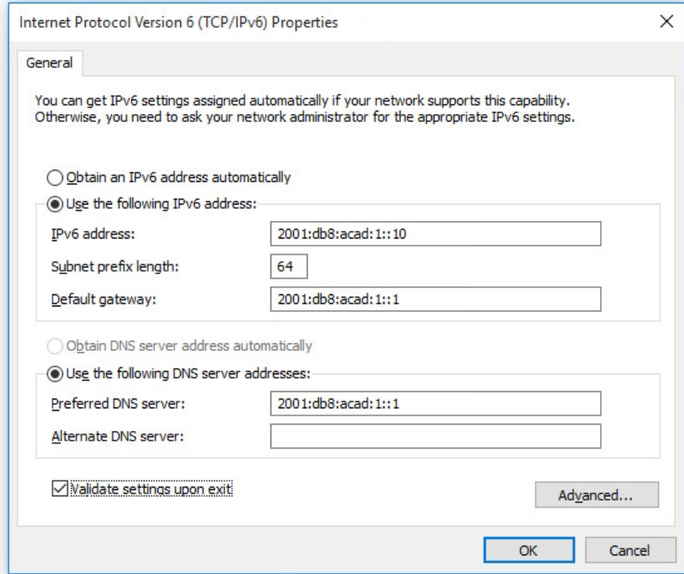

Manually entering an IPv6 GUA can be time consuming and somewhat error prone. Therefore, most Windows host are enabled to
dynamically acquire an IPv6 GUA configuration, as shown in the figure.

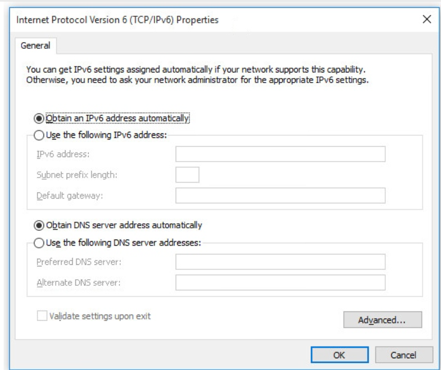

## 8.1.2 IPv6 Host Link-Local Address

When automatic IPv6 addressing is selected, the host will attempt to automatically obtain and configure IPv6 address information on the interface. The host will use one of three methods defined by the Internet Control Message Protocol version 6 (ICMPv6) Router Advertisement (RA) message received on the interface. An IPv6 router that is on the same link as the host sends out RA messages that suggest to the hosts how to obtain their IPv6 addressing information. The IPv6 link-local address is automatically created by the host when it boots and the Ethernet interface is active. The example ipconfig output shows an automatically generated link-local address (LLA) on an interface.

In the figure, notice that the interface does not have an IPv6 GUA. The reason is because, in this example, the network segment does not have a router to provide network configuration instructions for the host or the host has not been configured with at static IPv6 address.

Note: Host operating systems will at times show a link-local address appended with a "%" and a number. This is known as a Zone ID or Scope ID. It is used by the OS to associate the LLA with a specific interface.

```
C: \PC1> ipconfig
Windows IP Configuration
Ethernet adapter Ethernet:
Connection-specific DNS Suffix .:
IPv6 Address. ... ....:
Link-local IPv6 Address  ..: fe80:: fb:1d54: 839f: f595%21
IPv4 Address. ... ....: 169.254.202.140
Subnet Mask . ... ...: 255.255.0.0
Default Gateway . . .:
C: PC1>
```

## 8.1.3 IPv6 GUA Assignment
IPv6 was designed to simplify how a host can acquire its IPv6 configuration. By default, an IPv6-enabled router advertises its IPv6 information. This allows a host to dynamically create or acquire its IPv6 configuration.

The IPv6 GUA can be assigned dynamically using stateless and stateful services, as shown in the figure.

All stateless and stateful methods in this module use IMPv RA messages to suggest to the host how to create or acquire its IPv6 configuration. Although host operating systems follow the suggestion of the RA, the actual decision is ultimately up to the host.

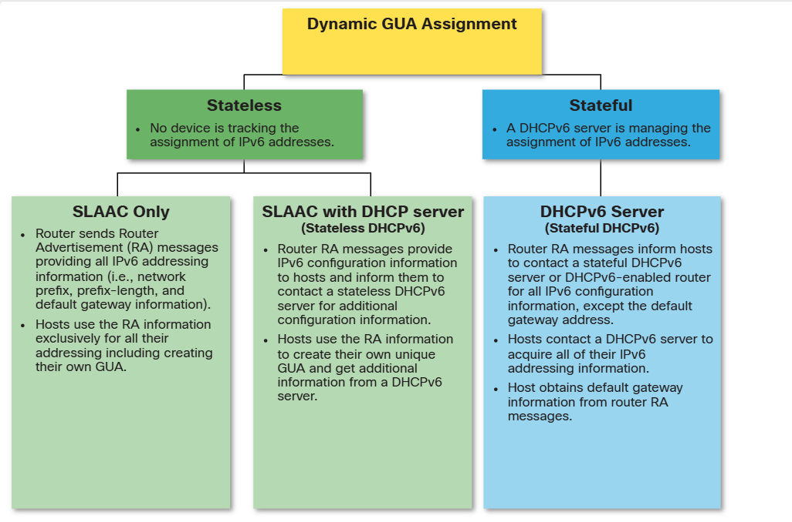

## 8.1.4 Three RA Message Flags

The decision of how a client will obtain an IPv6 GUA depends on the settings within the RA message.

An ICMPv6 RA message includes three flags to identify the dynamic options available to a host, as follows:

*   **A flag** - This is the Address Autoconfiguration flag. Use Stateless Address Autoconfiguration (SLAAC) to create an IPv6 GUA.
*   **O flag** - This is the Other Configuration flag. Other information is available from a stateless DHCPv6 server.
*   **M flag** - This is the Managed Address Configuration flag. Use a stateful DHCPv6 server to obtain an IPv6 GUA.

Using different combinations of the A, O and M flags, RA messages inform the host about the dynamic options available.

The figure illustrates these three methods.

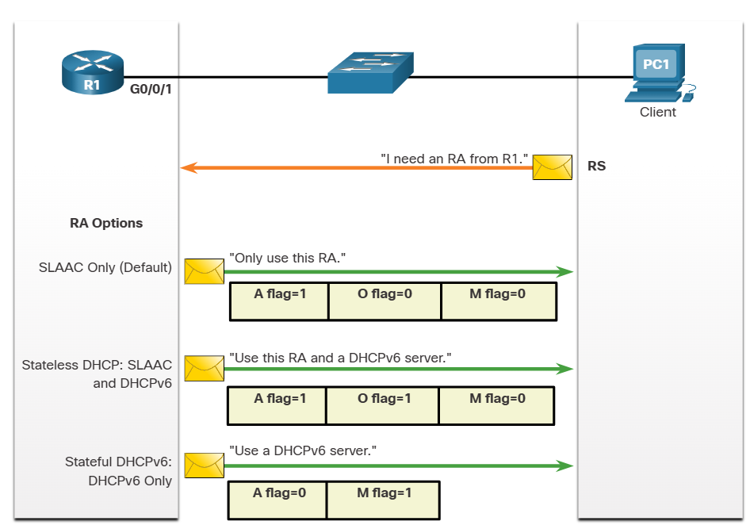

# 8.2 SLAAC 

## 8.2.1 SLAAC Overview

Not every network has or needs access to a DHCPv6 server. But every device in an IPv6 network needs a GUA. The SLAAC method enables hosts to create their own unique IPv6 global unicast address without the services of a DHCPv6 server. SLAAC is a stateless service. This means there is no server that maintains network address information to know which Pv6 addresses are being used and which ones are available.

SLAAC uses ICMPv6 RA messages to provide addressing and other configuration information that would normally be provided by a DHCP server. A host configures its IPv address based on the information that is sent in the RA. RA messages are sent by an IPv6 router every 200 seconds.

A host can also send a Router Solicitation (RS) message requesting that an IPv6-enabled router send the host an RA. SLAAC can be deployed as SLAAC only, or SLAAC with DHCPv6.

## 8.2.2 Enabling SLAAC

Refer to the following topology to see how SLAAC is enabled to provide stateless dynamic GUA allocation.

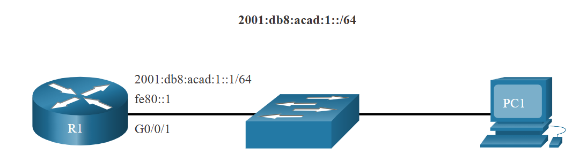

Assume R1 GigabitEthernet 0/0/1 has been configured with the indicated IPv6 GUA and link-local addresses. Click each button for an explanation of how R1 is enabled for SLAAC.

### Verify IPv6 Addresses 

The output of the show ipv6 interface command displays the current settings on the G0/0/1 interface.
As highlighted, R1 has been assigned the following IPv6 addresses:
• Link-local IPv6 address - fe80::1
• GUA and subnet - 2001:db8:acad:1::1 and 2001:db8:acad: 1::/64
• IPv6 all-nodes group - ff02::1

```
R1# show ipv6 interface G0/0/1
GigabitEthernet0/0/1 is up, line protocol is up
IPv6 is enabled, link-local address is FE80: :1
No Virtual link-local address (es):
Description: Link to LAN
Global unicast address(es):
2001:DB8: ACAD: 1: 1, subnet is 2001:DB8: ACAD: 1: :/64
Joined group address (es) :
FF02: :1
FF02:: 1: FF00:1
(output omitted)
R1#
```

### Enable IPv6 Routing 

Although the router interface has an IPv6 configuration, it is still not yet enabled to send RAs containing address configuration information to hosts using SLAAC. To enable the sending of RA messages, a router must join the IPv6 all-routers group using the ipv unicast-routing global config command, as show in the output.

```
R1(config)# ipv6 unicast-routing
R1(config)# exit
R1#
```

### Verify SLAAC is Enabled 

The IPv6 all-routers group responds to the IPv6 multicast address ff02::2. You can use the show ipv6 interface command to verify if a router is enabled as shown, in the output. An IPv6-enabled Cisco router sends RA messages to the IPv6 all-nodes multicast address ff02::1 every 200 seconds.

```
R1# show ipv6 interface G0/0/1 | section Joined
Joined group address (es) :
FF02: :1
FF02: :2
FF02::1: FF00:1
R1#
```

## 8.2.3 SLAAC Only Method

The SLAAC only method is enabled by default when the ipv unicast-routing command is configured. All enabled Ethernet interfaces with an IPv6 GUA configured will start sending RA messages with the A flag set to 1, and the O and M flags set to 0, as shown in the figure.

The A = 1 flag suggests to the client that it create its own IPv6 GUA using the prefix advertised in the RA. The client can create its own

Interface ID using either Extended Unique Identifier method (EUI-64) or have it randomly generated.

The O =0 and M=0 flags instruct the client to use the information in the RA message exclusively. The RA includes the prefix, prefix-length, DNS server, MTU, and default gateway information. There is no further information available from a DHCPv6 server.

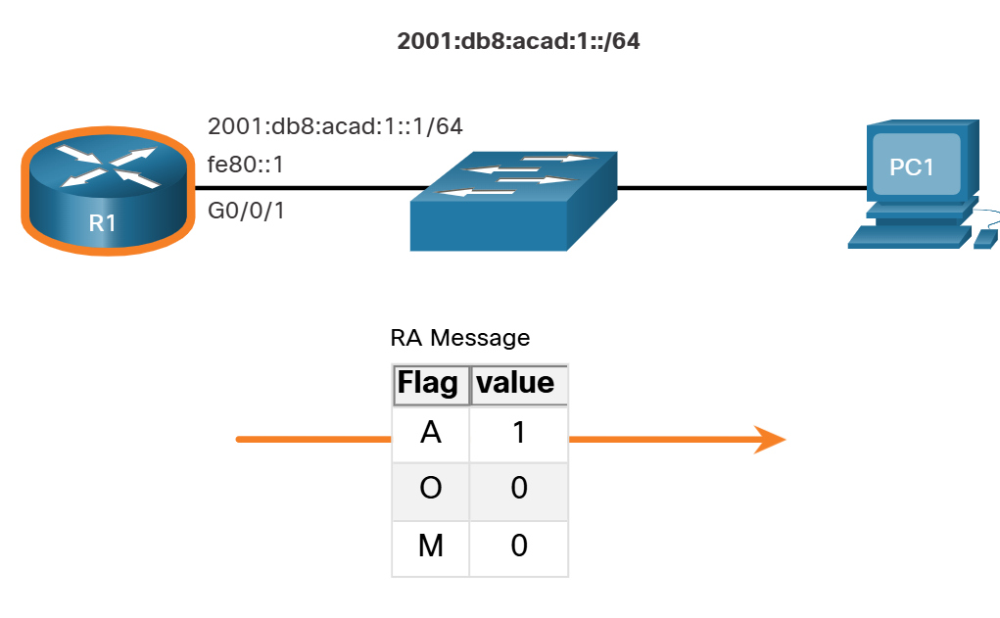

In the example, PC1 is enabled to obtain its IPv addressing information automatically. Because of the settings of the A, O and M flags, PC1 performs SLAAC only, using the information contained in the RA message sent by R1. The default gateway address is the source Pv6 address of the RA message, which is the LLA for R1. The default gateway can only be obtained automatically from the RA message. A DHCPv6 server does not provide this information.

```
C: \PC1> ipconfig
Windows IP Configuration
Ethernet adapter Ethernet0:
Connection-specific DNS Suffix
IPv6 Address...........: ..........:2001:db8:acad:1:1de9:c69:73ee:ca8c
Link-local IPv6 Address . . . ..: fe80:: fb: 1d54:839f: f595%21
IPv4 Address... . . ...• .: 169.254.202.140
Subnet Mask ... • .: 255.255.0.0
Default Gateway . . .: fe80:: 1%21
C: \PC1>
```

## 8.2.4 ICMPv6 RS Messages
A router sends RA messages every 200 seconds. However, it will also send an RA message if it receives an RS message from a host. When a client is configured to obtain its addressing information automatically, it sends an RS message to the IPv6 all-routers multicast address of ff02::2.

The figure illustrates how a host initiates the SLAAC method.

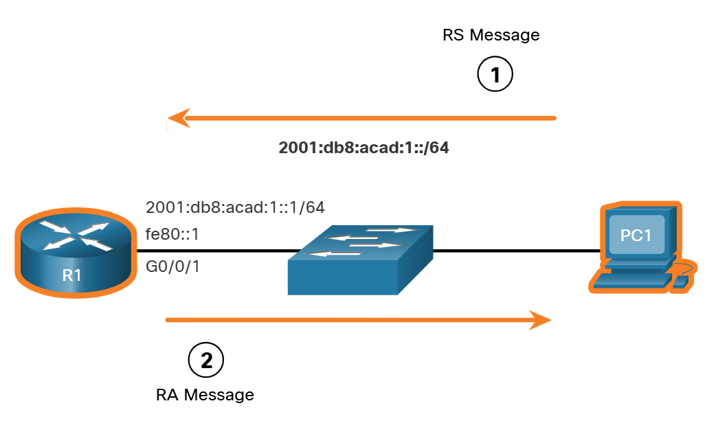

1. PC1 has just booted and has not yet received an RA message. Therefore, it sends an RS message to the IPv6 all-routers multicast address of ff02:2 requesting an RA.
2. R1 is part of the IPv6 all-routers group and received the RS message. It generates an RA containing the local network prefix and prefix length (e.g.. 2001:db8:acad: 1:/64). It then sends the RA message to the IPv6 all-nodes multicast address of ff02:1. PC1 uses this information to create a unique IPv6 GUA.

## 8.2.5 Host Process to Generate Interface ID

Using SLAAC, a host typically acquires its 64-bit IPv6 subnet information from the router RA. However, it must generate the remainder 64-bit interface identifier (ID) using one of two methods:
• Randomly generated - The 64-bit interface ID is randomly generated by the client operating system. This is the method now used by Windows 10 hosts.
• EUI-64 - The host creates an interface ID using its 48-bit MAC address. The host inserts the hex value of fffe in the middle of the address, and flips the seventh bit of the interface ID. This changes the value of the second hexadecimal digit of the interface ID. Some operating systems default to the randomly generated interface ID instead of the EUI-64 method, due to privacy concerns. This is because the Ethernet MAC address of the host is used by EUI-64 to create the interface ID.

Note: Windows, Linux, and MacOS allow for the user to modify the generation of the interface ID to be either randomly generated or to use EUI-64.

For instance, in the following ipconfig output, the Windows 10 PC1 host used the IPv6 subnet information contained in the R1 RA and randomly generated a 64-bit interface ID as highlighted in the output.

```
C: \PC1> ipconfig
Windows IP Configuration
Ethernet adapter Etherneto:
Connection-specific DNS Suffix
IPv6 Address. . . . . .: 2001:db8: acad: 1:1de9: c69:73ee: ca8c
Link-local IPv6 Address . . . .:fe80:: fb: 1d54:839f: f595%21
IPv4 Address. . . .: 169.254.202.140
Subnet Mask . . . .: 255.255.0.0
Default Gateway . . . .: fe80: : 1%6
C: \PC1>
```

## 8.2.6 Duplicate Address Detection

The process enables the host to create an IPv6 address. However, there is no guarantee that the address is unique on the network. SLAAC is a stateless process; therefore, a host has the option to verify that a newly created IPv6 address is unique before it can be used.

The Duplicate Address Detection (DAD) process is used by a host to ensure that the IPv6 GUA is unique. DAD is implemented using ICMPv6. To perform DAD, the host sends an ICMPv6 Neighbor Solicitation (NS) message with a specially constructed multicast address, called a solicited-node multicast address. This address duplicates the last 24 bits of IPv6 address of the host.

If no other devices respond with a NA message, then the address is virtually guaranteed to be unique and can be used by the host. If an NA is received by the host, then the address is not unique, and the operating system has to determine a new interface ID to use.

The Internet Engineering Task Force (IETF) recommends that DAD is used on all IPv6 unicast addresses regardless of whether it is created using SLAAC only, obtained using stateful DHCPv6, or manually configured. DAD is not mandatory because a 64-bit interface ID provides 18 quintillion possibilities and the chance that there is a duplication is remote. However, most operating systems perform DAD on all IPv6 unicast addresses, regardless of how the address is configured.

# 8.3 DHCPv6 

## 8.3.1 DHCPv6 Operation Steps

This topic explains stateless and stateful DHCPv6. Stateless DHCPv6 uses parts of SLAAC to ensure that all the necessary information is supplied to the host. Stateful DHCPv6 does not require SLAAC.

Although DHCPv6 is similar to DHCPv4 in what it provides, the two protocols are independent of each other.

Note: DHCPv6 is defined in RFC 3315.

The host begins the DHCPv6 client/server communications after stateless DHCPv6 or stateful DHCPv6 is indicated in the RA. Server to client DHCPv6 messages use UDP destination port 546 while client to server DHCPv6 messages use UDP destination port 547.

The steps for DHCPv6 operations are as follows:
1. The host sends an RS message.
2. The router responds with an RA message.
3. The host sends a DHCPv6 SOLICIT message.
4. The DHCPv6 server responds with an ADVERTISE message.
5. The host responds to the DHCPv6 server.
6. The DHCPv6 server sends a REPLY message.

### Step 1. Host sends an RS message.

PC1 sends an RS message to all IPv6-enabled routers.

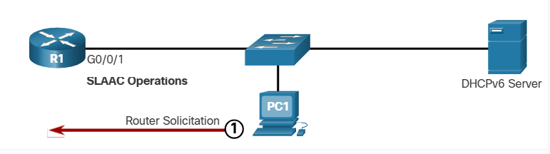

### Step 2. Router responds with an RA message.

R1 receives the RS and responds with an RA indicating that the client is to initiate communication with a DHCPv6 server.

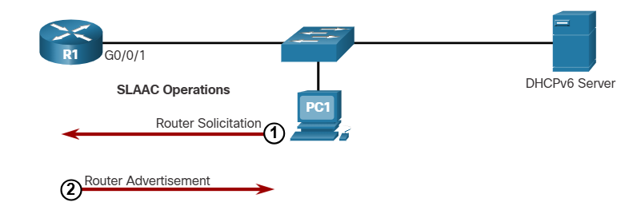

### Step 3. Host sends a DHCPv6 SOLICIT message.

The client, now a DHCPv6 client, needs to locate a DHCPv6 server and sends a DHCPv6 SOLICIT message to the reserved IPv6 multicast all-DHCPv6-servers address of ff02::1:2. This multicast address has link-local scope, which means routers do not forward the messages to other networks.

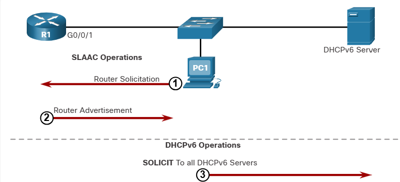

### Step 4. DHCPv6 server responds with an ADVERTISE message.

One or more DHCPv6 servers respond with a DHCPv6 ADVERTISE unicast message. The ADVERTISE message informs the DHCPv6 client that the server is available for DHCPv6 service.

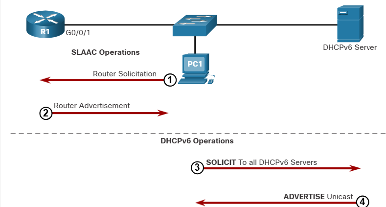

### Step 5. Host responds to DHCPv6 server.

The PC1 response depends on whether it is using stateful or stateless DHCPv6:
• Stateless DHCPv6 client - The client creates an IPv6 address using the prefix in the RA message and a self-generated Interface ID. The client then sends a DHCPv6 INFORMATION-REQUEST message to the DHCPv6 server requesting additional configuration parameters (e.g., DNS server address).
• Stateful DHCPv6 client - The client sends a DHCPv6 REQUEST message to the DHCPv6 server to obtain all necessary IPv6 configuration parameters.

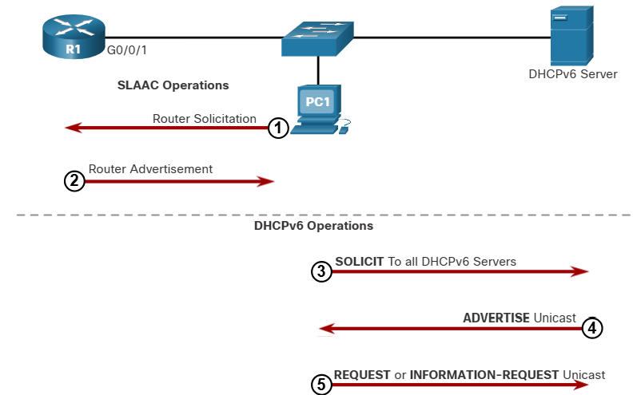

### Step 6. DHCPv6 sends a REPLY message.

The server sends a DHCPv6 REPLY unicast message to the client. The content of the message varies depending on if it is replying to a REQUEST or INFORMATION-REQUEST message.

Note: The client will use the source IPv6 Link-local address of the RA as its default gateway address. A DHCPv6 server does not provide this information.

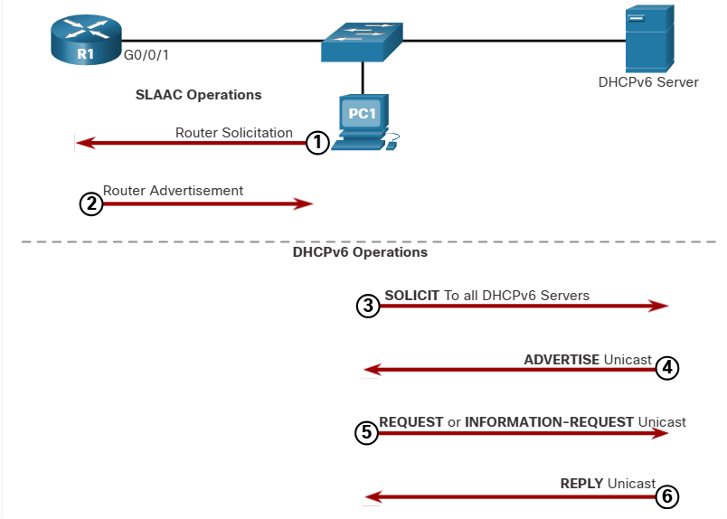


## 8.3.2 Stateless DHCPv6 Operation

The stateless DHCPv6 server is only providing information that is identical for all devices on the network such as the IPv6 address of a DNS server.

This process is known as stateless DHCPv6 because the server is not maintaining any client state information (i.e., a list of available and allocated IPv6 addresses). The stateless DHCPv6 server is only providing configuration parameters for clients, not IPv6 addresses.

The figure illustrates stateless DHCPv6 operation.

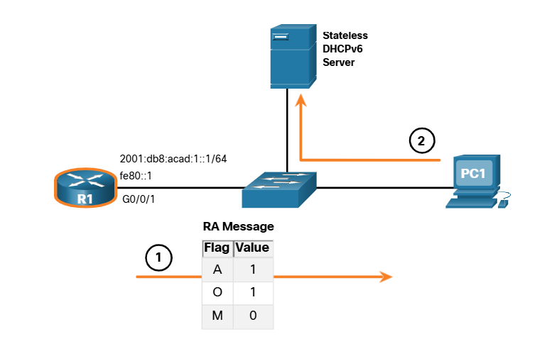

1. PC1 receives a stateless DHCP RA message. The RA message contains the network prefix and prefix length. The M flag for stateful DHCP is set to the default value 0. The A=1 flag tells the client to use SLAAC. The O= 1 flag informs the client that additional configuration information is available from a stateless DHCPvé
2. The client sends a DHCPv6 SOLICIT message looking for a stateless DHCPv6 server to obtain additional information (e.g., DNS server addresses).

## 8.3.3 Enable Stateless DHCPv6 on an Interface

Stateless DHCPv6 is enabled on a router interface using the ipv6 nd other-config-flag interface configuration command. This sets the O flag to 1.

The highlighted output confirms the RA will tell receiving hosts to use stateless autoconfigure (A flag = 1) and contact a DHCPv6 server to obtain another configuration information (O flag = 1).

Note: You can use the no ipv6 nd other-config-flag to reset the interface to the default SLAAC only option (O flag = 0).

```
R1(config-if)# ipv6 nd other-config-flag
R1(config-if)# end
R1#
R1# show ipv6 interface g0/0/1| begin ND
ND DAD is enabled, number of DAD attempts: 1
ND reachable time is 30000 milliseconds (using 30000)
ND advertised reachable time is 0 (unspecified)
ND advertised retransmit interval is 0 (unspecified)
ND router advertisements are sent
every 200 seconds
ND router advertisements live for 1800 seconds
ND advertised default router preference is Medium
Hosts use stateless autoconfig for addresses.
Hosts use DHCP to obtain other configuration.
R1#
```

## 8.3.4 Stateful DHCPv6 Operation

This option is most similar to DHCPV4. In this case, the RA message tells the client to obtain all addressing information from a stateful DHCPv6 server, except the default gateway address which is the source IPv6 link-local address of the RA.

This is known as stateful DHCPv6 because the DHCPv6 server maintains IPv6 state information. This is similar to a DHCPv4 server allocating addresses for IPv4.

The figure illustrates stateful DHCPv6 operation.

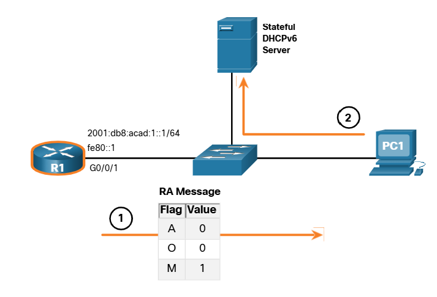

1. PC1 receives a DHCPv6 RA message with the O flag set to 0 and the M flag set to 1, indicating to PC1 that it will receive all its IPv6 addressing information from a stateful DHCPv6 server.
2. PC1 sends a DHCPv6 SOLICIT message looking for a stateful DHCPv6 server.

Note: If A=1 and M=1, some operating systems such as Windows will create an IPv6 address using SLAAC and obtain a different address from the stateful DHCPv6 server. In most cases it is recommended to manually set the A flag to O.

## 8.3.5 Enable Stateful DHCPv6 on an Interface

Stateful DHCPv6 is enabled on a router interface using the ipv6 nd managed-config-flag interface configuration command. This sets the M flag to 1. The ipv6 nd prefix default no-autoconfig interface command disables SLAAC by setting the A flag to 0. The highlighted output in the example confirms that the RA will tell the host to obtain all IPv6 configuration information from a DHCPv6 server (M flag = 1).

```
R1(config)# int g0/0/1
R1(config-if)# ipv6 nd managed-config-flag
R1(config-if)# ipv6 nd prefix default no-autoconfig
R1(config-if)# end
R1#
R1# show ipv6 interface g0/0/1 | begin ND
ND DAD is enabled, number of DAD attempts: 1
ND reachable time is 30000 milliseconds (using 30000)
ND advertised reachable time is 0 (unspecified)
ND advertised retransmit interval is 0 (unspecified)
ND router advertisements are sent every 200 seconds
ND router advertisements live for 1800 seconds
ND advertised default router preference is Medium
Hosts
use DHCP to obtain routable addresses.
R1#
```

# 8.4 Configure DHCPv6 Server 

## 8.4.1 DHCPv6 Router Roles

Cisco IOS routers are powerful devices. In smaller networks, you do not have to have separate devices to have a DHCPv6 server, client, or relay agent. A Cisco IOS router can be configured to provide DHCPv6 server services.

Specifically, it can be configured to be one of the following:
• DHCPv6 Server - Router provides stateless or stateful DHCPV6 services.
• DHCPv6 Client - Router interface acquires an IPv6 IP configuration from a DHCPv6 server.
• DHCPv6 Relay Agent - Router provides DHCPv6 forwarding services when the client and the server are located on different networks.

## 8.4.2 Configure a Stateless DHCPv6 Server

The stateless DHCPv6 server option requires that the router advertise the IPv6 network addressing information in RA messages. However, the client must contact a DHCPv6 server for more information.

Refer to the sample topology to learn how to configure the stateless DHCPv6 server method.

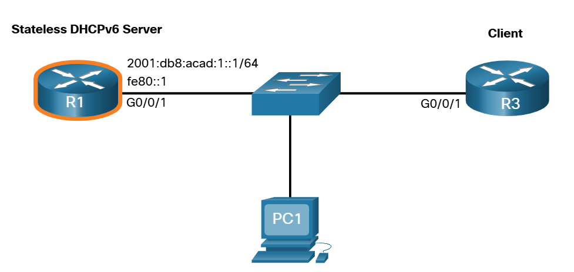

In this example, R1 will provide SLAAC services for the host IPv6 configuration and DHCPv6 services.

There are five steps to configure and verify a router as a stateless DHCPv6 server:

### Step 1. Enable IPv6 routing.

The ipv6 unicast-routing command is required to enable IPv6 routing. Although it is not necessary for the router to be a stateless DHCPV6 server, it is required for the router to source ICMPV6 RA messages.

```
R1(config)# ipv6 unicast-routing
R1 (config)#
```

### Step 2. Define a DHCPv6 pool name.

Create the DHCPv6 pool using the ipv6 dhcp pool POOL-NAME global config command. This enters DHCPv6 pool sub- configuration mode as identified by the Router(config-dhcpv6)# prompt.

Note: The pool name does not have to be uppercase. However, using an uppercase name makes it easier to see in a configuration.

```
R1(config)# ipv6 dhcp pool IPV6-STATELESS
R1 (config-dhcpv6)#
```

### Step 3. Configure the DHCPv6 pool.

R1 will be configured to provide additional DHCP information including DNS server address and domain name, as shown in the command output.

```
R1(config-dhcpv6)# dns-server 2001:db8:acad:1::254
R1(config-dhcpv6)# domain-name example.com
R1(config-dhcpv6)# exit
R1(config)#
```


### Step 4. Bind the DHCPv6 pool to an interface.
The DHCPv6 pool has to be bound to the interface using the ipv6 dhcp server POOL-NAME interface config command as shown in the output.

The router responds to stateless DHCPv6 requests on this interface with the information contained in the pool. The O flag needs to be manually changed from 0 to 1 using the interface command ipv6 nd other-config-flag. RA messages sent on this interface indicate that additional information is available from a stateless DHCPv6 server. The A flag is 1 by default, telling clients to use SLAAC to create their own GUA.

```
R1(config)# interface GigabitEthernet0/0/1
R1(config-if)# description Link to LAN
R1(config-if)# ipv6 address fe80::1 link-local
R1(config-if)# ipv6 address 2001:db8: acad: 1::1/64
R1(config-if)# ipv6 nd other-config-flag
R1(config-if)# ipv6 dhcp server IPV6-STATELESS
R1(config-if)# no shut
R1(config-if)# end
R1#
```


### Step 5. Verify hosts received IPv6 addressing information.

To verify stateless DHCP on a Windows host, use the ipconfig /all command. The example output displays the settings on PC1. Notice in the output that PC1 created its IPv6 GUA using the 2001:db8:acad: 1:/64 prefix. Also notice that the default gateway is the IPv6 link-local address of R1. This confirms that PC1 derived its IPv6 configuration from the RA of R1.

The highlighted output confirms that PC1 has learned the domain name and DNS server address information from the stateless DHCPv6 server.

```
C:\PC1> ipconfig /all
Windows IP Configuration
Ethernet adapter Ethernet0:
Connection-specific DNS Suffix . . . . .: example.com
Description . . . . . . . . . . . . . .: Intel(R) 82574L Gigabit Network Connection
Physical Address. . . . . . . . . . . .: 00-05-9A-3C-7A-00
DHCP Enabled. . . . . . . . . . . . .: Yes
Autoconfiguration Enabled . . . . . .: Yes
IPv6 Address. . . . . . . . . . . . .: 2001:db8:acad:1:1de9:c69:73ee:ca8c (Preferred)
Link-local IPv6 Address . . . . . . .: fe80::fb:1d54:839f:f595%21 (Preferred)
IPv4 Address. . . . . . . . . . . . .: 169.254.102.23 (Preferred)
Subnet Mask . . . . . . . . . . . . .: 255.255.0.0
Default Gateway . . . . . . . . . . .: fe80::1%6
DHCPv6 IAID . . . . . . . . . . . . .: 318768538
DHCPv6 Client DUID. . . . . . . . . .: 00-01-00-01-21-F3-76-75-54-E1-AD-DE-DA-9A
DNS Servers . . . . . . . . . . . . .: 2001:db8:acad:1::254
NetBIOS over Tcpip. . . . . . . . . .: Enabled
C:\PC1>
```

## 8.4.3 Configure a Stateless DHCPv6 Client

A router can also be a DHCPv6 client and get an IPv6 configuration from a DHCPv6 server, such as a router functioning as a DHCPv6 server. In the figure, R1 is a stateless DHCPv6 server.

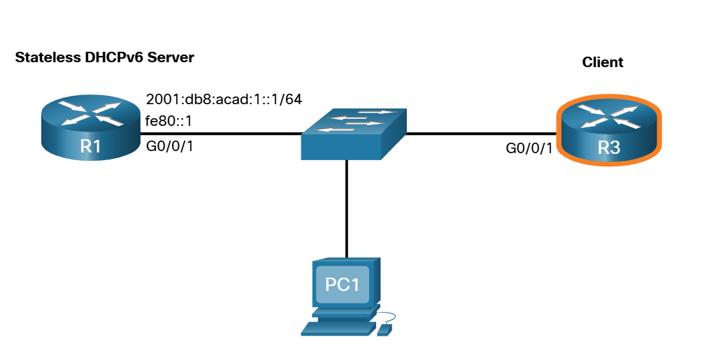

There are five steps to configure and verify a router as a stateless DHCPv6 client.

### Step 1. Enable IPv6 routing.

The DHCPv6 client router needs to have ipv6 unicast-routing enabled.

```
R3(config)# ipv6 unicast-routing
R3(config)#
```

### Step 2. Configure client router to create an LLA.

The client router needs to have a link-local address. An IPv6 link-local address is created on a router interface when a global unicast address is configured. It can also be created without a GUA using the ipv6 enable interface configuration command. Cisco IOS uses EUI-64 to create a randomized Interface ID.

In the output, the ipv6 enable command is configured on the Gigabit Ethernet 0/0/1 interface of the R3 client router.

```
R3(config)# interface g0/0/1
R3(config-if)# ipv6 enable
R3(config-if)#
```

### Step 3. Configure client router to use SLAAC.

The client router needs to be configured to use SLAAC to create an IPv6 configuration. The ipv6 address autoconfig command enables the automatic configuration of IPv6 addressing using SLAAC.

```
R3(config-if)# ipv6 address autoconfig
R3(config-if)# end
R3#
```

### Step 4. Verify client router is assigned a GUA.

Use the show ipv6 interface brief command to verify the host configuration as shown. The output confirms that the G0/0/1 interface on R3 was assigned a valid GUA.

Note: it may take the interface a few seconds to complete the process.

```
R3# show ipv6 interface brief
GigabitEthernet0/0/0 [up/up]
    unassigned
GigabitEthernet0/0/1 [up/up]
    FE80::2FC:BAFF:FE94:29B1
    2001:DB8:ACAD:1:2FC:BAFF:FE94:29B1
Serial0/1/0 [up/up]
    unassigned
Serial0/1/1 [up/up]
    unassigned
R3#
```

### Step 5. Verify client router received other DHCPv6 information.

The show ipv6 dhcp interface g0/0/1 command confirms that the DNS and domain names were also learned by R3.

```
R3# show ipv6 dhcp interface g0/0/1
GigabitEthernet0/0/1 is in client mode
Prefix State is IDLE (0)
Information refresh timer expires in 23:56:06
Address State is IDLE
List of known servers:
Reachable via address: FE80::1
DUID: 000300017079B3923640
Preference: 0
Configuration parameters:
DNS server: 2001:DB8:ACAD:1::254
Domain name: example.com
Information refresh time: 0
Prefix Rapid-Commit: disabled
Address Rapid-Commit: disabled
R3#
```

## 8.4.4 Configure a Stateful DHCPv6 Server

The stateful DHCP server option requires that the IPv6 enabled router tells the host to contact a DHCPv6 server to obtain all necessary IPv6 network addressing information.

In the figure, R1 will provide stateful DHCPv6 services to all hosts on the local network. Configuring a stateful DHCPv6 server is similar to configuring a stateless server. The most significant difference is that a stateful DHCPv6 server also includes IPv6 addressing information similar to a DHCPv4 server.

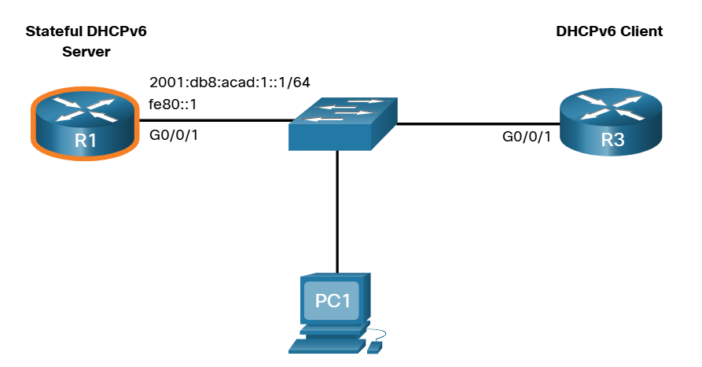

There are five steps to configure and verify a router as a stateful DHCPv6 server:

### Step 1. Enable IPv6 routing.

The ipv6 unicast-routing command is required to enable IPv6 routing.

```
R1(config)# ipv6 unicast-routing
R1(config)#
```

### Step 2. Define a DHCPv6 pool name.

Create the DHCPv6 pool using the ipv6 dhcp pool POOL-NAME global config command.

```
R1(config)# ipv6 dhcp pool IPV6-STATEFUL
R1(config-dhcpv6)#
```

### Step 3. Configure the DHCPv6 pool.

R1 will be configured to provide IPv6 addressing, DNS server address, and domain name, as shown in the command output. With stateful DHCPv6, all addressing and other configuration parameters must be assigned by the DHCPv6 server. The **address prefix** command is used to indicate the pool of addresses to be allocated by the server. Other information provided by the stateful DHCPv6 server typically includes DNS server address and the domain name, as shown in the output.

Note: This example is setting the DNS server to Google's public DNS server.

```
R1(config-dhcpv6)# address prefix 2001:db8:acad:1::/64
R1(config-dhcpv6)# dns-server 2001:4860:4860::8888
R1(config-dhcpv6)# domain-name example.com
R1(config-dhcpv6)#
```

### Step 4. Bind the DHCPv6 pool to an interface.

The example shows the full configuration of the GigabitEthernet 0/0/1 interface on R1. The DHCPv6 pool has to be bound to the interface using the ipv6 dhcp server POOL-NAME interface config command.
• The M flag is manually changed from 0 to 1 using the interface command ipv6 nd managed-config-flag.
• The A flag is manually changed from 1 to 0 using the interface command ipv6 nd prefix default no-autoconfig. The A flag can be left at 1, but some client operating systems such as Windows will create a GUA using SLAAC and get a GUA from the stateful DHCPv6 server. Setting the A flag to 0 tells the client not to use SLAAC to create a GUA.
• The ipv6 dhcp server command binds the DHCPv6 pool to the interface. R1 will now respond with the information contained in the pool when it receives stateful DHCPv6 requests on this interface.

Note: You can use the no ipv6 nd managed-config-flag command to set the M flag back to its default of O. The no ipv6 nd prefix default no-autoconfig command sets the A flag back to its default of 1.

```
R1(config)# interface GigabitEthernet0/0/1
R1(config-if)# description Link to LAN
R1(config-if)# ipv6 address fe80::1 link-local
R1(config-if)# ipv6 address 2001:db8:acad:1::1/64
R1(config-if)# ipv6 nd managed-config-flag
R1(config-if)# ipv6 nd prefix default no-autoconfig
R1(config-if)# ipv6 dhcp server IPV6-STATEFUL
R1(config-if)# no shut
R1(config-if)# end
R1#
```

### Step 5. Verify hosts received IPv6 addressing information.

To verify on a Windows host, use the ipconfig /all command to verify the stateless DHCP configuration method. The output displays the settings on PC1. The highlighted output shows that PC1 has received its IPv6 GUA from a stateful DHCPV6 server.

```
C:\PC1> ipconfig /all
Windows IP Configuration
Ethernet adapter Ethernet0:
Connection-specific DNS Suffix . . . . . : example.com
Description . . . . . . . . . . . . . . . : IntelI 82574L Gigabit Network Connection
Physical Address. . . . . . . . . . . . : 00-05-9A-3C-7A-00
DHCP Enabled. . . . . . . . . . . . . . : Yes
Autoconfiguration Enabled . . . . . . . : Yes
IPv6 Address. . . . . . . . . . . . . . : 2001:db8:acad:1:a43c:fd28:9d79:9e42 (Preferred)
Lease Obtained. . . . . . . . . . . . . : Saturday, September 27, 2019, 10:45:30 AM
Lease Expires . . . . . . . . . . . . . : Monday, September 29, 2019 10:05:04 AM
Link-local IPv6 Address . . . . . . . . : fe80::192f:6fbc:9db:b749%6 (Preferred)
Autoconfiguration IPv4 Address. . . . . : 169.254.102.73 (Preferred)
Subnet Mask . . . . . . . . . . . . . . : 255.255.0.0
Default Gateway . . . . . . . . . . . . : fe80::1%6
DHCPv6 IAID . . . . . . . . . . . . . . : 318768538
DHCPv6 Client DUID. . . . . . . . . . . : 00-01-00-01-21-F3-76-75-54-E1-AD-DE-DA-9A
DNS Servers . . . . . . . . . . . . . . : 2001:4860:4860::8888
NetBIOS over Tcpip. . . . . . . . . . . : Enabled
C:\PC1>
```

## 8.4.5 Configure a Stateful DHCPv6 Client

A router can also be a DHCPv6 client. The client router needs to have ipv6 unicast-routing enabled and an IPv6 link-local address to send and receive IPv6 messages.

Refer to the sample topology to learn how to configure the stateful DHCPv6 client.

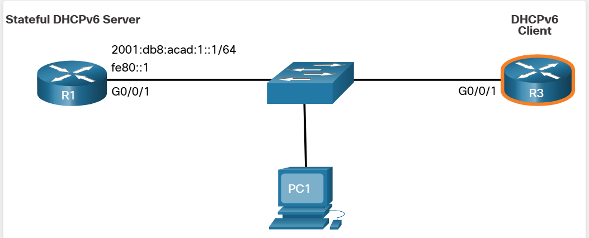

There are five steps to configure and verify a router as a stateful DHCPv6 client.

### Step 1. Enable IPv6 routing.

The DHCPv6 client router needs to have ipv6 unicast-routing enabled.

```
R3 (config)# ipv6 unicast-routing
R3(config)#
```


### Step 2. Configure client router to create an LLA.

In the output, the ipv6 enable command is configured on the R3 Gigabit Ethernet 0/0/1 interface. This enables the router to create an IPv6 LLA without needing a GUA.

```
R3(config)# interface g0/e/1
R3(config-if)# ipv6 enable
R3 (config-if)#
```

### Step 3. Configure client router to use DHCPv6.

The ipv6 address dhep command configures R3 to solicit its IPv6 addressing information from a DHCPv6 server.

```
R3 (config-if)# ipv6 address dhcp
R3(config-if)# end
R3#
```

### Step 4. Verify client router is assigned a GUA.

Use the show ipv6 interface brief command to verify the host configuration as shown.

```
R3# show ipv6 interface brief
GigabitEthernet0/0/0 [up/up]
unassigned
GigabitEthernet0/0/1 [up/up]
FE80::2FC:BAFF:FE94:29B1
2001:DB8:ACAD:1:B4CB:25FA:3C9:747C
Serial0/1/0 [up/up]
unassigned
Serial0/1/1 [up/up]
unassigned
R3#
```

### Step 5. Verify client router received other DHCPv6 information.

The show ipv6 dhcp interface g0/0/1 command confirms that the DNS and domain names were learned by R3.


```
R3# show ipv6 dhcp interface g0/0/1
GigabitEthernet0/0/1 is in client mode
Prefix State is IDLE
Address State is OPEN
Renew for address will be sent in 11:56:33
List of known servers:
Reachable via address: FE80::1
DUID: 000300017079B3923640
Preference: 0
Configuration parameters:
IA NA: IA ID 0x00060001, T1 43200, T2 69120
Address: 2001:DB8:ACAD:1:B4CB:25FA:3C9:747C/128
preferred lifetime 86400, valid lifetime 172800
expires at Sep 29 2019 11:52 AM (172593 seconds)
DNS server: 2001:4860:4860::8888
Domain name: example.com
Information refresh time: 0
Prefix Rapid-Commit: disabled
Address Rapid-Commit: disabled
R3#
```


## 8.4.6 DHCPv6 Server Verification Commands

Use the show ipv6 dhcp pool and show ipv6 dhcp binding commands to verify DHCPv6 operation on a router.

### show ipv6 dhcp pool 

The show ipv6 dhcp pool command verifies the name of the DHCPv6 pool and its parameters. The command also identifies the number of active clients. In this example, the IPV6-STATEFUL pool currently has 2 clients, which reflects PC1 and R3 receiving their IPv6 global unicast address from this server.

When a router is providing stateful DHCPv6 services, it also maintains a database of assigned IPv6 addresses.

```
R1# show ipv6 dhcp pool
DHCPv6 pool: IPV6-STATEFUL
    Address allocation prefix: 2001:DB8:ACAD: 1::/64 valid 172800 preferred 86400 (2 in use, 0 conflicts)
    DNS server: 2001:4860:4860:: 8888
    Domain name: example.com
    Active clients: 2
R1#
```

### show ipv6 dhcp binding 

Use the show ipv6 dhcp binding command output to display the IPv6 link-local address of the client and the global unicast address assigned by the server.
The output displays the current stateful binding on R1. The first client in the output is PC1 and the second client is R3. This information is maintained by a stateful DHCPv6 server. A stateless DHCPv6 server would not maintain this information.

```
R1# show ipv6 dhcp binding
Client: FE80::192F:6FBC:9DB:B749
    DUID: 0001000125148183005056B327D6
    Username : unassigned
    VRF : default
    IA NA: IA ID 0x03000C29, T1 43200, T2 69120
    Address: 2001:DB8:ACAD:1:A43C:FD28:9D79:9E42
        preferred lifetime 86400, valid lifetime 172800
        expires at Sep 27 2019 09:10 AM (171192 seconds)

Client: FE80::2FC:BAFF:FE94:29B1
    DUID: 0003000100FCBA9429B0
    Username : unassigned
    VRF : default
    IA NA: IA ID 0x00060001, T1 43200, T2 69120
    Address: 2001:DB8:ACAD:1:B4CB:25FA:3C9:747C
        preferred lifetime 86400, valid lifetime 172800
        expires at Sep 27 2019 09:29 AM (172339 seconds)

R1#
```

## 8.4.7 Configure a DHCPv6 Relay Agent

If the DHCPv6 server is located on a different network than the client, then the IPv6 router can be configured as a DHCPv6 relay agent. The configuration of a DHCPv6 relay agent is similar to the configuration of an IPv4 router as a DHCPv4 relay.

In the figure, R3 is configured as a stateful DHCPv6 server. PC1 is on the 2001:db8:acad:2::/64 network and requires the services of a stateful DHCPv6 server to acquire its IPv configuration. R1 needs to be configured as the DHCPv6 Relay Agent.

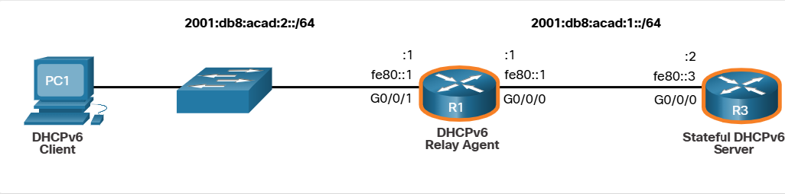

The command syntax to configure a router as a DHCPv6 relay agent is as follows:

```
Router (config-if)# ipv6 dhcp relay destination ipv6-address [interface-type interface-number]
```

This command is configured on the interface facing the DHCPv6 clients and specifies the DCPv6 server address and egress interface to reach the server, as shown in the output. The egress interface is only required when the next-hop address is an LLA.

```
R1(config)# interface gigabitethernet 0/e/1
R1(config-if)# ipv6 dhcp relay destination 2001:db8:acad:1::2 G0/0/0
R1(config-if)# exit
R1(config)#
```

## 8.4.8 Verify the DHCPv6 Relay Agent

Verify that the DHCPv6 relay agent is operational with the show ipv dhcp interface and show ipv6 dhcp binding commands. Verify Windows hosts received IPv6 addressing information with the ipconfig /all command.

### show ipv6 dhcp interface 

The DHCPv6 relay agent can be verified using the show ipv dhcp interface command. This will verify that the GO/0/1 interface is in relay mode.

```
R1# show ipv6 dhcp interface
GigabitEthernet0/0/1 is in relay mode
Relay destinations:
    2001: DB8: ACAD:1:: 2
    2001:DB8:ACAD:1: :2 via GigabitEthernet0/0/0
R1#
```

### show ipv6 dhcp binding 

On R3, use the show ipv6 dhcp binding command to verify if any hosts have been assigned an IPv6 configuration. Notice that a client link-local address has been assigned an IPv6 GUA. We can assume that this is PC1.

```
R3# show ipv6 dhcp binding
Client: FE80::5C43:EE7C: 2959 :DA68
    DUID: 0001000124F5CEA2005056B3636D
    Username : unassigned
    VRF : default
    IANA: IA ID 0x03000C29, T1 43200, T2 69120
    Address: 2001:DB8:ACAD: 2:9C3C: 64DE: AADA: 7857
        preferred lifetime 86400, valid lifetime 172800
        expires at Sep 29 2019 08:26 PM (172710 seconds)
R3#
```

### ipconfig /all

Finally, use ipconfig /all on PC1 to confirm that it has been assigned an IPv6 configuration. As you can see, PC1 has indeed received its IPv6 configuration from the DHCPv6 server.

```
C:\PC1> ipconfig /all
Windows IP Configuration
Ethernet adapter Ethernet0:
Connection-specific DNS Suffix . : example.com
Description . . . . . . . . . . . : Intel(R) 82574L Gigabit Network Connection
Physical Address. . . . . . . . . : 00-05-9A-3C-7A-00
DHCP Enabled. . . . . . . . . . . : Yes
Autoconfiguration Enabled . . . . : Yes
IPv6 Address. . . . . . . . . . . : 2001:db8:acad:2:9c3c:64de:aada:7857 (Preferred)
Link-local IPv6 Address . . . . . : fe80::5c43:ee7c:2959:da68%6(Preferred)
Lease Obtained. . . . . . . . . . : Saturday, September 27, 2019, 11:45:30 AM
Lease Expires . . . . . . . . . . : Monday, September 29, 2019 11:05:04 AM
IPv4 Address. . . . . . . . . . . : 169.254.102.73 (Preferred)
Subnet Mask . . . . . . . . . . . : 255.255.0.0
Default Gateway . . . . . . . . . : fe80::1%6
DHCPv6 Iaid . . . . . . . . . . . : 318768538
DHCPv6 Client DUID. . . . . . . . : 00-01-00-01-21-F3-76-75-54-E1-AD-DE-DA-9A
DNS Servers . . . . . . . . . . . : 2001:4860:4860::8888
NetBIOS over Tcpip. . . . . . . . : Enabled
C:\PC1>
```
