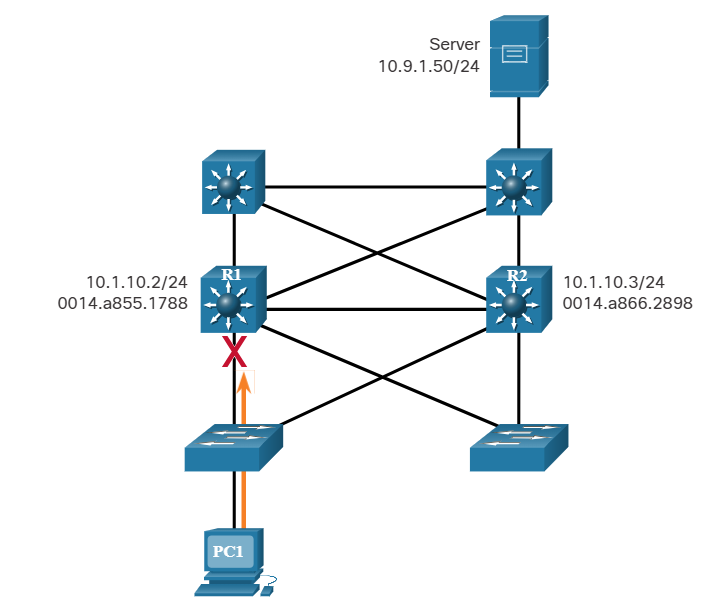
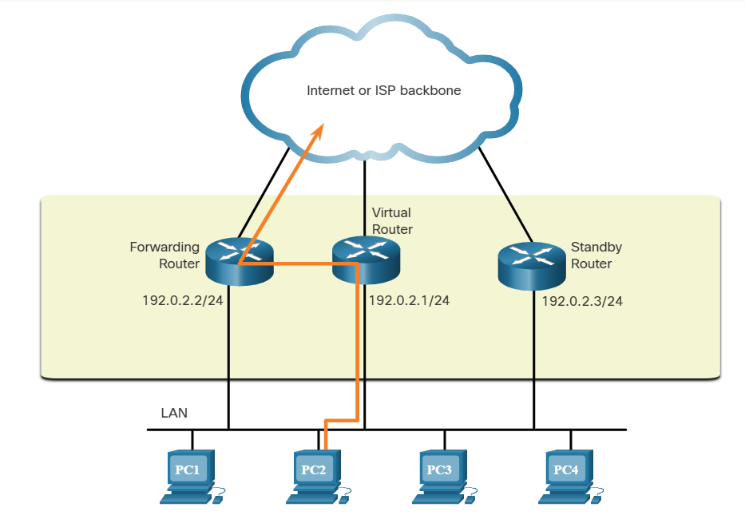
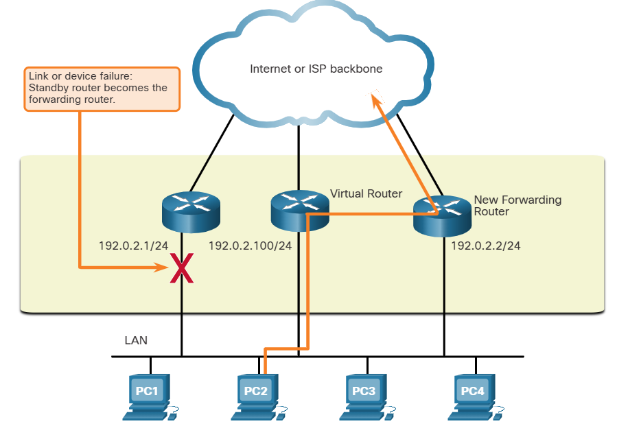
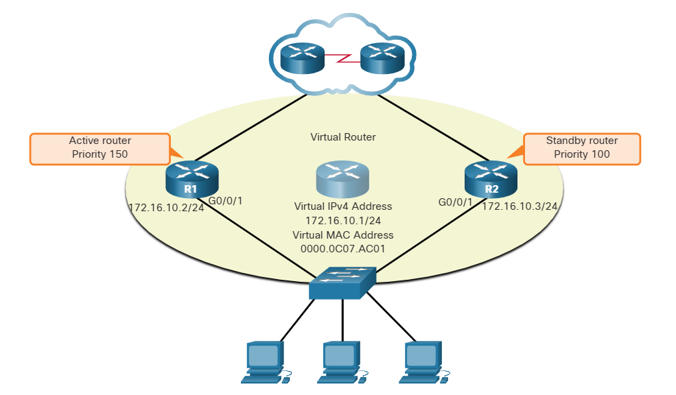

# Module 9: FHRP Concepts 

# 9.1 First Hop Redundancy Protocols 

## 9.1.1 Default Gateway Limitations

If a router or router interface (that serves as a default gateway) fails, the hosts configured with that default gateway are isolated from outside networks. A mechanism is needed to provide alternate default gateways in switched networks where two or more routers are connected to the same VLANs. That mechanism is provided by first hop redundancy protocols (FHRPs).

In a switched network, each client receives only one default gateway. There is no way to use a secondary gateway, even if a second path exists to carry packets off the local segment.

In the figure, R1 is responsible for routing packets from PC1. If R1 becomes unavailable, the routing protocols can dynamically converge. R2 now routes packets from outside networks that would have gone through R1. However, traffic from the inside network associated with R1, including traffic from workstations, servers, and printers configured with R1 as their default gateway, are still sent to R1 and dropped.

Note: For the purposes of the discussion on router redundancy, there is no functional difference between a Layer 3 switch and a router at the distribution layer. In practice, it is common for a Layer 3 switch to act as the default gateway for each VLAN in a switched network. This discussion focuses on the functionality of routing, regardless of the physical device used.

PC1 is unable to reach the default gateway.

End devices are typically configured with a single IPv4 address for a default gateway. This address does not change when the network topology changes. If that default gateway IPv4 address cannot be reached, the local device is unable to send packets off the local network segment, effectively disconnecting it from other networks. Even if a redundant router exists that could serve as a default gateway for that segment, there is no dynamic method by which these devices can determine the address of a new default gateway.

Note: IPv6 devices receive their default gateway address dynamically from the ICMPv6 Router Advertisement. However, IPv6 devices benefit with a faster failover to the new default gateway when using FHRP.

## 9.1.2 Router Redundancy

One way to prevent a single point of failure at the default gateway is to implement a virtual router. To implement this type of router redundancy, multiple routers are configured to work together to present the illusion of a single router to the hosts on the LAN, as shown in the figure. By sharing an IP address and a MAC address, two or more routers can act as a single virtual router.

The IPv4 address of the virtual router is configured as the default gateway for the workstations on a specific IPv4 segment. When frames are sent from host devices to the default gateway, the hosts use ARP to resolve the MAC address that is associated with the IPv4 address of the default gateway. The ARP resolution returns the MAC address of the virtual router. Frames that are sent to the MAC address of the virtual router can then be physically processed by the currently active router within the virtual router group. A protocol is used to identify two or more routers as the devices that are responsible for processing frames that are sent to the MAC or IP address of a single virtual router. Host devices send traffic to the address of the virtual router. The physical router that forwards this traffic is transparent to the host devices.

A redundancy protocol provides the mechanism for determining which router should take the active role in forwarding traffic. It also determines when the forwarding role must be taken over by a standby router. The transition from one forwarding router to another is transparent to the end devices.

The ability of a network to dynamically recover from the failure of a device acting as a default gateway is known as first-hop redundancy.

## 9.1.3 Steps for Router Failover

When the active router fails, the redundancy protocol transitions the standby router to the new active router role, as shown in the figure.

These are the steps that take place when the active router fails:
1. The standby router stops seeing Hello messages from the forwarding router.
2. The standby router assumes the role of the forwarding router.
3. Because the new forwarding router assumes both the IPv4 and MAC addresses of the virtual router, the host devices see no disruption in service.

## 9.1.4 FHRP Options

The FHRP used in a production environment largely depends on the equipment and needs of the network. The table lists all the options available for FHRPs.

| FHRP Options | Description |
|---|---|
| Hot Standby Router Protocol (HSRP) | HSRP is a Cisco-proprietary FHRP that is designed to allow for transparent failover of a first-hop IPv4 device. HSRP provides high network availability by providing first-hop routing redundancy for IPv4 hosts on networks configured with an IPv4 default gateway address. HSRP is used in a group of routers for selecting an active device and a standby device. In a group of device interfaces, the active device is the device that is used for routing packets; the standby device is the device that takes over when the active device fails, or when pre-set conditions are met. The function of the HSRP standby router is to monitor the operational status of the HSRP group and to quickly assume packet-forwarding responsibility if the active router fails. |
| HSRP for IPv6 | This is a Cisco-proprietary FHRP that provides the same functionality of HSRP, but in an IPv6 environment. An HSRP IPv6 group has a virtual MAC address derived from the HSRP group number and a virtual IPv6 link-local address derived from the HSRP virtual MAC address. Periodic router advertisements (RAs) are sent for the HSRP virtual IPv6 link-local address when the HSRP group is active. When the group becomes inactive, these RAs stop after a final RA is sent. |
| Virtual Router Redundancy Protocol version 2 (VRRPv2) | This is a non-proprietary election protocol that dynamically assigns responsibility for one or more virtual routers to the VRRP routers on an IPv4 LAN. This allows several routers on a multiaccess link to use the same virtual IPv4 address. A VRRP router is configured to run the VRRP protocol in conjunction with one or more other routers attached to a LAN. In a VRRP configuration, one router is elected as the virtual router master, with the other routers acting as backups, in case the virtual router master fails. |
| VRRPv3 | This provides the capability to support IPv4 and IPv6 addresses. VRRPv3 works in multi-vendor environments and is more scalable than VRRPv2. |
| Gateway Load Balancing Protocol (GLBP) | This is a Cisco-proprietary FHRP that protects data traffic from a failed router or circuit, like HSRP and VRRP, while also allowing load balancing (also called load sharing) between a group of redundant routers. |
| GLBP for IPv6 | This is a Cisco-proprietary FHRP that provides the same functionality of GLBP, but in an IPv6 environment. GLBP for IPv6 provides automatic router backup for IPv6 hosts configured with a single default gateway on a LAN. Multiple first-hop routers on the LAN combine to offer a single virtual first-hop IPv6 router while sharing the IPv6 packet forwarding load. |
| ICMP Router Discovery Protocol (IRDP) | Specified in RFC 1256, IRDP is a legacy FHRP solution. IRDP allows IPv4 hosts to locate routers that provide IPv4 connectivity to other (nonlocal) IP networks. |

# 9.2 HSRP

## 9.2.1 HSRP Overview

Cisco provides HSRP and HSRP for IPv6 as a wayto avoid losing outside network access if your default router fails.

HSRP is a Cisco-proprietary FHRP that is designed to allow for transparent failover of a first-hop IP device.

HSRP ensures high network availability by providing first-hop routing redundancy for IP hosts on networks configured with an IP default gateway address. HSRP is used in a group of routers for selecting an active device and a standby device. In a group of device interfaces, the active device is the device that is used for routing packets; the standby device is the device that takes over when the active device fails, or when pre-set conditions are met. The function of the HSRP standby router is to monitor the operational status of the HSRP group and to quickly assume packet-forwarding responsibility if the active router fails.

## 9.2.2 HSRP Priority and Preemption

The role of the active and standby routers is determined during the HSRP election process. By default, the router with the numerically highest IPv4 address is elected as the active router. However, it is always better to control how your network will operate under normal conditions rather than leaving it to chance.

### HSRP Priority

HSRP priority can be used to determine the active router. The router with the highest HSRP priority will become the active router. By default, the HSRP priority is 100. If the priorities are equal, the router with the numerically highest IPv4 address is elected as the active router.

To configure a router to be the active router, use the standby priority interface command. The range of the HSRP priority is 0 to 255. 

### HSRP Preemption 

By default, after a router becomes the active router, it will remain the active router even if another router comes online with a higher HSRP priority.

To force a new HSRP election process to take place when a higher priority router comes online, preemption must be enabled using the standby preempt interface command. Preemption is the ability of an HSRP router to trigger the re-election process. With preemption enabled, a router that comes online with a higher HSRP priority will assume the role of the active router. 

Preemption only allows a router to become the active router if it has a higher priority. A router enabled for preemption, with equal priority but a higher |Pv4 address will not preempt an active router. Refer to the topology in the figure.

R1 has been configured with the HSRP priority of 150 while R2 has the default HSRP priority of 100. Preemption has been enabled on R1. With a higher priority, R1 is the active router and R2 is the standby router. Due to a power failure affecting only R1, the active router is no longer available and the standby router, R2, assumes the role of the active router. After power is restored, R1 comes back online.

Because R1 has a higher priority and preemption is enabled, it will force a new election process. R1 will re-assume the role of the active router and R2 will fall back to the role of the standby router.

Note: With preemption disabled, the router that boots up first will become the active router if there are no other routers online during the election process.

## 9.2.3 HSRP States and Timers

A router can either be the active HSRP router responsible for forwarding traffic for the segment, or it can be a passive HSRP router on standby, ready to assume the active role if the active router fails. When an interface is configured with HSRP or is first activated with an existing HSRP configuration, the router sends and receives HSRP hello packets to begin the process of determining which state it will assume in the HSRP group.

The table summarizes the HSRP states.

| HSRP State | Description |
|---|---|
| Initial | This state is entered through a configuration change or when an interface first becomes available. |
| Learn | The router has not determined the virtual IP address and has not yet seen a hello message from the active router. In this state, the router waits to hear from the active router. |
| Listen | The router knows the virtual IP address, but the router is neither the active router nor the standby router. It listens for hello messages from those routers. |
| Speak | The router sends periodic hello messages and actively participates in the election of the active and/or standby router. |
| Standby | The router is a candidate to become the next active router and sends periodic hello messages. |
| Active | The router won the election. |

The active and standby HSRP routers send hello packets to the HSRP group multicast address every 3 seconds by default. The standby router will become active if it does not receive a hello message from the active router after 10 seconds. You can lower these timer settings to speed up the failover or preemption. However, to avoid increased CPU usage and unnecessary standby state changes, do not set the hello timer below 1 second or the hold timer below 4 seconds.

